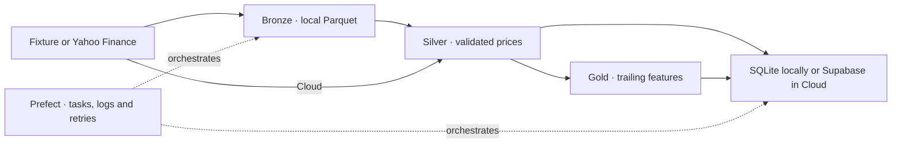

# Market Data ML Pipeline

A runnable Data Engineering 101 workshop. Fetch historical daily open, high, low, close and volume (OHLCV), save raw Parquet, validate and calculate features in Polars, and load SQLite locally or Supabase from Prefect Cloud. The resulting tables are inputs for a later ML workshop.



## Start reading here

Open [the historical ingestion notebook](notebooks/01_historical_ingestion.ipynb) to run the lesson cell by cell. It links to the functions it calls, shows two Matplotlib charts, and includes an optional exercise on how Polars filters and summarizes Parquet.

```sh
uv sync --locked --group notebook
```

In VS Code, open the notebook and select the project's `.venv` under **Select Kernel → Python Environments**. Run the cells in order. The default lesson uses the fixture and local Prefect. Section 5 writes and queries the local SQLite database. [VS Code notebook kernel guide](https://code.visualstudio.com/docs/datascience/jupyter-kernel-management)

For the code walkthrough, start at `run_command` in [cli.py](src/market_data/cli.py), then read the task calls at the bottom of [the historical ingestion flow](src/market_data/flows/historical_ingestion.py). Open each task and follow the plain Python function it calls. Use [the annotated reading order](docs/ARCHITECTURE.md#read-the-code-in-this-order) alongside the [60-minute instructor guide](docs/INSTRUCTOR_DEMO.md).

## Repository layout

```text
src/market_data/
  cli.py                         Run, backfill, catch up, serve, and count
  flows/historical_ingestion.py  Prefect flow and its four tasks
  ingest.py                      Read the fixture or Yahoo and write Bronze
  validate.py                    Enforce the Silver schema and quality rules
  transform.py                   Calculate trailing features in Polars
  storage.py                     Load Silver and Gold in SQLite or PostgreSQL
  data/market_sample.csv         Packaged synthetic fixture
notebooks/                       Run the guided ingestion lesson
sql/                             Create the tables and verify a load
tests/                           Exercise the adapter, rules, flow, and database
docs/                            Instructor guide and deployment instructions
```

The importable package uses Python's `src/` layout. The `flows/` directory gives each future workflow its own named entrypoint. Tasks for the current flow live alongside the flow, with data logic in the modules they call. [Python Packaging User Guide](https://packaging.python.org/en/latest/discussions/src-layout-vs-flat-layout/) · [Prefect YAML entrypoints](https://www.prefect.io/docs/v3/how-to-guides/deployments/prefect-yaml)

## Five-minute fixture quickstart

Install [uv](https://docs.astral.sh/uv/getting-started/installation/), open a terminal in this repository, and run:

```sh
uv python install 3.12
uv sync --locked
cp .env.example .env
uv run --offline --locked market-data run --source fixture
uv run --locked market-data counts --source fixture
```

In PowerShell, use `Copy-Item .env.example .env` for the copy. Preserve your existing `.env` if you already configured it. The first install needs package access. After installation the fixture run needs only loopback access for Prefect's temporary server. Use a local Prefect profile or the local server below if your active profile points to Cloud.

Expect **30 Silver rows**, **30 Gold preview rows**, a Bronze path under `data/bronze/`, and **30 rows in each SQLite table**. `XAUUSD-DEMO` contains synthetic values for instruction. Its 30 weekday examples span January 6 through February 14, 2025. The fixture lives inside the Python package so it also ships in a wheel.

To inspect Bronze, use the file path printed by `save_bronze`:

```sh
uv run python -c "import polars as pl; print(pl.read_parquet('PASTE_BRONZE_PATH_HERE').head())"
```

## Inspect SQLite and prove repeatability

The local run creates `data/market_data.sqlite3` automatically. SQLite ships with Python and stores the tables in that file. The notebook's Section 5 runs a SQL join to show the stored prices and features. You can also open the file in a SQLite viewer.

```sh
uv run market-data run --source fixture
uv run market-data counts --source fixture
uv run market-data run --source fixture
uv run market-data counts --source fixture
```

Both count checks should show 30 rows and 30 distinct keys in each table for `XAUUSD-DEMO`. Each rerun makes a new Bronze snapshot. Silver and Gold update existing keys.

Set `SQLITE_DB_PATH` to use another local file, or pass `--skip-db` to preview without writing either table. For an explicit PostgreSQL connection test, configure `DATABASE_URL` in the ignored `.env` and use `--require-db`. For the hosted path, follow the [Supabase and Prefect Secret block setup](docs/DEPLOYMENT.md#create-the-supabase-secret-block).

## Run live and repair historical ranges

The default live ticker is Yahoo's gold futures series, `GC=F`. During verification Yahoo returned no historical data for the requested spot-gold ticker `XAUUSD=X`, which you can still request explicitly. `AAPL` is another example. [Yahoo Finance gold futures](https://finance.yahoo.com/quote/GC%3DF/)

```sh
# Recent history with the default gold futures ticker
uv run market-data run --source yfinance --skip-db

# Explicit date range for gold futures, saved to local SQLite
uv run market-data backfill --source yfinance --symbol 'GC=F' --start-date 2025-01-06 --end-date 2025-02-15

# Catch up that symbol using the stored maximum date and a 7-calendar-day overlap
uv run market-data catch-up --source yfinance --symbol 'GC=F'
```

`--start-date` is inclusive and `--end-date` is exclusive. Live runs default to the prior 60 calendar days through yesterday UTC. Catch-up uses 60 days on first load and overlaps the most recent 7 calendar dates including the last stored date on subsequent runs. Repeat `--symbol` to request multiple Yahoo tickers. Use an explicit backfill when you know an older date range needs repair. Detecting arbitrary gaps requires an exchange calendar that accounts for weekends and holidays. A Prefect schedule creates future runs.

## Practice catch-up after missed runs

The scheduled Cloud deployment uses the same catch-up logic as the local command. At the start of each run, the flow reads the latest committed trade date per ticker from Silver. For live data, the end of the window defaults to today's UTC date, which is excluded. It fetches from six calendar days before the latest saved date through the exclusive end. That gives seven days of overlap, including the saved date, plus every later available session. On the first live load, it requests the preceding 60 calendar days.

Try it with a fresh SQLite file. The commands run in a subshell so your existing workshop database stays available after the exercise.

```sh
(
  demo_dir=$(mktemp -d)
  export SQLITE_DB_PATH="$demo_dir/catch-up.sqlite3"
  export BRONZE_DIR="$demo_dir/bronze"

  uv run market-data catch-up --source fixture --end-date 2025-01-18
  uv run market-data counts --source fixture

  # Pretend the worker missed the next two weeks.
  uv run market-data catch-up --source fixture --end-date 2025-02-01
  uv run market-data counts --source fixture

  uv run market-data catch-up --source fixture --end-date 2025-02-01
  uv run market-data counts --source fixture
)
```

| Run | Latest date before the run | Requested window, end exclusive | Stored rows per table afterward |
| --- | --- | --- | ---: |
| First load | No rows | Jan 6 to Jan 18, 2025 | 10 |
| Catch up after the outage | Jan 17 | Jan 11 to Feb 1, 2025 | 20 |
| Repeat with the same end date | Jan 31 | Jan 25 to Feb 1, 2025 | 20 |

The second run fetches 15 fixture sessions, adds 10 missing rows and updates 5 overlapping rows. The third run updates 5 rows and adds zero. If the database transaction fails, its latest committed date stays where it was. Catch-up covers the missing tail after that date. To repair a gap further back in stored history, use the manual backfill command with explicit dates.

## Prefect UI and local daily schedule

In terminal 1, from the repository root:

```sh
export PREFECT_API_URL=http://127.0.0.1:4200/api
export PREFECT_SERVER_UI_API_URL=http://127.0.0.1:4200/api
export PREFECT_API_KEY=
uv run --locked prefect server start --host 127.0.0.1 --port 4200
```

In terminal 2:

```sh
export PREFECT_API_URL=http://127.0.0.1:4200/api
export PREFECT_API_KEY=
uv run market-data run --source fixture
uv run market-data serve --source fixture
```

`PREFECT_API_URL` directs Python and the CLI to the local API. `PREFECT_SERVER_UI_API_URL` directs the browser there, even if your active Prefect profile points to Cloud. These exports apply to the current terminal. In PowerShell, use `$env:PREFECT_API_URL = 'http://127.0.0.1:4200/api'` and `$env:PREFECT_SERVER_UI_API_URL = $env:PREFECT_API_URL` in the server terminal. Open [the local Prefect UI](http://127.0.0.1:4200). Inspect the four task runs. The `workshop-daily` deployment schedules a run at 06:00 Africa/Accra. Keep both processes running. To launch immediately, use **Quick run** in the deployment screen or, from another terminal configured with the same API URL:

```sh
uv run prefect deployment run 'historical-ingestion/workshop-daily' --watch
```

For daily live catch-up into SQLite, use `uv run market-data serve --source yfinance --symbol 'GC=F' --incremental`. [Prefect deployment and scheduling docs](https://www.prefect.io/docs/v3/how-to-guides/deployments/create-deployments)

## Checks and deployment

```sh
uv run --locked ruff check .
uv run --locked ruff format --check .
uv run --locked pytest
```

Tests use fixture data, SQLite, and a local Prefect server. Set `TEST_DATABASE_URL` to a **disposable PostgreSQL database with no `market_data` schema** to include PostgreSQL tests. Those tests create and drop their own schema. GitHub Actions provides disposable PostgreSQL for every check run.

Use `dev` for workshop changes and `main` for releases. Once enabled, a passing push to `main` registers its exact Git commit as `hourly-ingestion/hourly-gold-bars`, this project's only Prefect Cloud deployment. The Prefect Managed pool fetches Yahoo data and uses a Prefect Secret block to connect to Supabase. The daily flow remains available in the notebook and through the local CLI. See [GitHub and Prefect deployment](docs/DEPLOYMENT.md) for the branches, credentials, and verification commands.

The [hourly walkthrough](docs/DEPLOYMENT.md#7-collect-hourly-gold-bars) uses a separate flow for gold futures. Start locally with `uv run market-data hourly` to load 12 synthetic Silver bars and their Gold features into SQLite. The Cloud deployment collects completed one-hour bars every six hours, Monday through Friday in Accra.

- [60-minute instructor walkthrough](docs/INSTRUCTOR_DEMO.md)
- [Architecture and ML handoff](docs/ARCHITECTURE.md)
- [Troubleshooting](docs/TROUBLESHOOTING.md)
- [Student assignment](docs/STUDENT_ASSIGNMENT.md)
