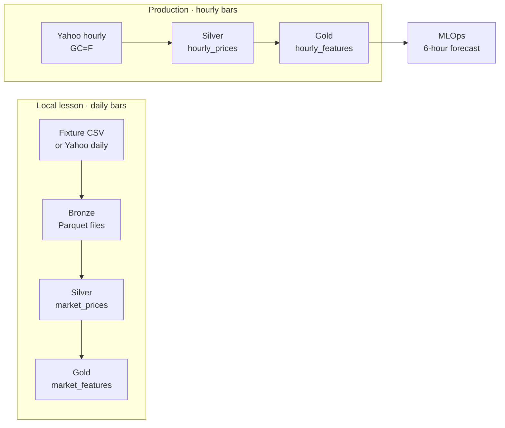

# Market Data ML Pipeline

A hands-on workshop in data engineering, DataOps and (next) MLOps. You follow gold price data from a raw source to validated, feature-ready tables. Prefect orchestrates the pipeline, GitHub Actions tests and releases it, and Prefect Cloud runs it on a schedule. The same tables then feed a forecasting model in the MLOps sessions.

Everything runs locally first, with no accounts and no network, using a small synthetic fixture. Cloud services come later and are optional.

## What you will learn

- **Medallion layers:** keep raw data in Bronze, enforce a contract in Silver, compute features in Gold
- **Data quality:** schema validation, fail-fast batches, schema drift, rescued data and quarantine
- **Repeatable loads:** primary keys, upserts and transactions, so a rerun never duplicates data
- **Incremental loads:** watermarks, overlap windows, catch-up after missed runs, and manual backfills
- **Orchestration:** Prefect flows, tasks, retries, schedules and deployments
- **DataOps:** locked environments, CI/CD from `dev` to `main`, secrets management and dependency auditing

## Learning path

| Step | Topic | Start here |
| --- | --- | --- |
| 0 | The theory: what a pipeline is and why each part exists | [Theory → Working Pipeline slides](https://gamma.app/docs/Theory-Working-Pipeline-s6v9hogx9py3t3s) |
| 1 | Build the pipeline locally, from Bronze to Silver to Gold in SQLite | [Notebook](notebooks/01_historical_ingestion.ipynb) · [quickstart](#five-minute-fixture-quickstart) |
| 2 | Read the code and the design | [Architecture and reading order](docs/ARCHITECTURE.md) |
| 3 | Orchestrate, recover missed runs, backfill | [Prefect UI](#prefect-ui-and-local-daily-schedule) · [catch-up exercise](#practice-catch-up-after-missed-runs) |
| 4 | Handle a source that changes shape | [Schema drift](docs/SCHEMA_DRIFT.md) |
| 5 | Keep credentials and dependencies safe | [Security](docs/SECURITY.md) |
| 6 | Release to production with GitHub, Prefect Cloud and Supabase | [Deployment](docs/DEPLOYMENT.md) |
| 7 | Hand the hourly data to the ML sessions | [MLOps kickoff](docs/MLOPS.md) |

Along the way: [roadmap](docs/ROADMAP.md) · [practice exercises and the assignment](docs/STUDENT_ASSIGNMENT.md) · [concepts map and further reading](docs/CONCEPTS.md) · [troubleshooting](docs/TROUBLESHOOTING.md) · [instructor guide](docs/INSTRUCTOR_DEMO.md)

## Architecture at a glance



| Path | Where it runs | What it produces |
| --- | --- | --- |
| Local daily lesson | The notebook or `market-data run --source fixture`, with local Prefect | Daily Bronze Parquet, plus Silver prices and Gold features in SQLite |
| Hosted hourly ingestion | `hourly-ingestion/hourly-gold-bars` in Prefect Cloud | Completed `GC=F` bars in Supabase `hourly_prices`, and trailing features in `hourly_features` |
| MLOps kickoff | Queries over the hourly tables | A forecast checkpoint, target and evaluation plan |

## Five-minute fixture quickstart

Install [uv](https://docs.astral.sh/uv/getting-started/installation/), open a terminal in this repository, and run:

```sh
uv python install 3.12
uv sync --locked
cp .env.example .env
uv run --offline --locked market-data run --source fixture
uv run --locked market-data counts --source fixture
```

In PowerShell, use `Copy-Item .env.example .env` instead of `cp`. Keep your existing `.env` if you already have one. The first install downloads packages. After that, the fixture run needs no network apart from a loopback connection to Prefect's temporary local server. If your active Prefect profile points to Cloud, use a local profile or the [local server](#prefect-ui-and-local-daily-schedule).

**Expected result:** **30 Silver rows**, **30 Gold preview rows**, a Bronze file path under `data/bronze/`, and **30 rows in each SQLite table**. `XAUUSD-DEMO` is **synthetic** teaching data, not real prices. It has 30 weekdays from January 6 to February 14, 2025. The CSV ships inside the Python package, so it works from any install.

To look inside Bronze, copy the path that `save_bronze` printed:

```sh
uv run python -c "import polars as pl; print(pl.read_parquet('PASTE_BRONZE_PATH_HERE').head())"
```

## Run the notebook

The [historical ingestion notebook](notebooks/01_historical_ingestion.ipynb) walks through the same pipeline one cell at a time. It links to every function it calls, draws two charts, and ends with an optional exercise on how Polars filters and summarizes Parquet.

```sh
uv sync --locked --group notebook
```

In VS Code, open the notebook, choose **Select Kernel → Python Environments**, and pick the project's `.venv`. Run the cells in order. Section 5 writes to the local SQLite database. [VS Code kernel guide](https://code.visualstudio.com/docs/datascience/jupyter-kernel-management)

## Read the code

Start at `run_command` in [cli.py](src/market_data/cli.py). Then read the task calls at the bottom of [the historical ingestion flow](src/market_data/flows/historical_ingestion.py), and open each task to find the plain Python function it calls. The [annotated reading order](docs/ARCHITECTURE.md#read-the-code-in-this-order) guides you file by file.

```text
src/market_data/
  cli.py                         Commands for local runs and backfills
  config.py                      Defaults, environment settings, input checks
  flows/                         Prefect: what runs, in what order, with what retries
    historical_ingestion.py      The local daily lesson
    hourly_ingestion.py          The hourly production flow
    _shared.py                   Retry rule and Secret block loading
  ingestion/                     Plain Python and Polars: the actual work
    sources.py                   Read the fixture or Yahoo, and write Bronze
    validation.py                Enforce the Silver contract and rescue new fields
    features.py                  Calculate trailing Gold features
    storage.py                   Upsert Silver and Gold in one transaction
    hourly.py                    Choose hourly windows and read the hourly fixture
  data/                          Packaged fixtures and the SQLite schema
notebooks/                       The guided lesson
sql/                             PostgreSQL schema and verification queries
security/                        Dependency audit runner and reviewed waivers
tests/                           Unit, flow and database tests
docs/                            Guides for students and instructors
```

**Design rule:** Prefect tasks in `flows/` only orchestrate. All business logic lives in plain functions in `ingestion/`, which you can test without Prefect. The package uses Python's [`src/` layout](https://packaging.python.org/en/latest/discussions/src-layout-vs-flat-layout/). Like a [Dataform repository](https://docs.cloud.google.com/dataform/docs/best-practices-repositories), it is organized around the stages a reader follows.

## Inspect SQLite and prove repeatability

The local run creates `data/market_data.sqlite3`. SQLite ships with Python and keeps every table in that one file. Open it with any SQLite viewer, or use the SQL cell in notebook Section 5.

Run the same load twice and compare counts:

```sh
uv run market-data run --source fixture
uv run market-data counts --source fixture
uv run market-data run --source fixture
uv run market-data counts --source fixture
```

Both checks should show 30 rows and 30 distinct keys in each table for `XAUUSD-DEMO`. This is **idempotency**: each rerun writes a new Bronze snapshot, but Silver and Gold update existing keys instead of adding duplicates.

Set `SQLITE_DB_PATH` to use another file, or pass `--skip-db` to preview without writing. To test against PostgreSQL, put `DATABASE_URL` in your ignored `.env` and add `--require-db`. For the hosted path, see the [Supabase and Secret block setup](docs/DEPLOYMENT.md#create-the-supabase-secret-block).

## Run live and repair historical ranges

The default live ticker is Yahoo's gold futures series, [`GC=F`](https://finance.yahoo.com/quote/GC%3DF/). During testing, Yahoo returned no history for spot gold, `XAUUSD=X`, but you can still request it explicitly. `AAPL` works too.

```sh
# Recent history for the default gold futures ticker (preview only)
uv run market-data run --source yfinance --skip-db

# Explicit date range, saved to local SQLite
uv run market-data backfill --source yfinance --symbol 'GC=F' --start-date 2025-01-06 --end-date 2025-02-15

# Continue from the latest stored date, re-reading 7 calendar days of overlap
uv run market-data catch-up --source yfinance --symbol 'GC=F'
```

- `--start-date` is **inclusive** and `--end-date` is **exclusive**.
- Live runs default to the previous 60 calendar days, up to and excluding today (UTC).
- Catch-up loads 60 days the first time. After that, it re-reads the 7 calendar days ending at the last stored date, plus everything newer.
- Repeat `--symbol` to load several tickers.

> **Limits of catch-up.** It only fills the *tail* after the latest stored date. It can't find a hole in older history. For that, run `backfill` with explicit dates. Detecting holes automatically needs an exchange calendar, because weekends and holidays aren't gaps. A Prefect schedule creates future runs only. It never backfills the past.

## Practice catch-up after missed runs

In the daily lesson, the flow reads the latest committed trade date for each ticker from Silver. It fetches from six calendar days before that date through the exclusive end. That gives seven days of overlap, including the saved date, plus every newer session. The [hourly flow](docs/DEPLOYMENT.md#7-collect-hourly-gold-bars) does the same with timestamps and a 24-hour overlap.

Try it with a throwaway database. The subshell keeps your workshop database untouched:

```sh
(
  demo_dir=$(mktemp -d)
  export SQLITE_DB_PATH="$demo_dir/catch-up.sqlite3"
  export BRONZE_DIR="$demo_dir/bronze"

  uv run market-data catch-up --source fixture --end-date 2025-01-18
  uv run market-data counts --source fixture

  # Pretend the worker missed the next two weeks.
  uv run market-data catch-up --source fixture --end-date 2025-02-01
  uv run market-data counts --source fixture

  uv run market-data catch-up --source fixture --end-date 2025-02-01
  uv run market-data counts --source fixture
)
```

| Run | Latest date before the run | Requested window, end exclusive | Rows per table afterwards |
| --- | --- | --- | ---: |
| First load | No rows | Jan 6 to Jan 18, 2025 | 10 |
| Catch up after the outage | Jan 17 | Jan 11 to Feb 1, 2025 | 20 |
| Repeat with the same end date | Jan 31 | Jan 25 to Feb 1, 2025 | 20 |

The second run fetches 15 sessions. It adds the 10 missing rows and updates the 5 overlapping ones. The third run updates 5 rows and adds none. If a transaction fails, the latest committed date doesn't move, so the next catch-up simply tries again.

## Prefect UI and local daily schedule

**Terminal 1**, from the repository root, starts the local Prefect server:

```sh
export PREFECT_API_URL=http://127.0.0.1:4200/api
export PREFECT_SERVER_UI_API_URL=http://127.0.0.1:4200/api
export PREFECT_API_KEY=
uv run --locked prefect server start --host 127.0.0.1 --port 4200
```

**Terminal 2** runs the flow once, then serves a daily schedule:

```sh
export PREFECT_API_URL=http://127.0.0.1:4200/api
export PREFECT_API_KEY=
uv run market-data run --source fixture
uv run market-data serve --source fixture
```

`PREFECT_API_URL` points Python and the CLI at the local API. `PREFECT_SERVER_UI_API_URL` points the browser there, even if your saved Prefect profile points to Cloud. The exports apply only to the current terminal. In PowerShell, use `$env:PREFECT_API_URL = 'http://127.0.0.1:4200/api'` and `$env:PREFECT_SERVER_UI_API_URL = $env:PREFECT_API_URL`.

Open [the local Prefect UI](http://127.0.0.1:4200) and inspect the task runs. The `workshop-daily` deployment is scheduled for 06:00 Africa/Accra. **Keep both terminals running**, because a schedule only creates runs and the `serve` process executes them. To start a run now, click **Quick run** on the deployment, or run this from another terminal with the same exports:

```sh
uv run prefect deployment run 'historical-ingestion/workshop-daily' --watch
```

For a daily live catch-up into SQLite, use `uv run market-data serve --source yfinance --symbol 'GC=F' --incremental`. [Prefect deployment docs](https://www.prefect.io/docs/v3/how-to-guides/deployments/create-deployments)

## Checks, branches and deployment

```sh
uv run --locked ruff check .
uv run --locked ruff format --check .
uv run --locked pytest
```

Tests use the fixtures, SQLite and a temporary local Prefect server, so they need no accounts. To include the PostgreSQL tests, set `TEST_DATABASE_URL` to a **disposable** database that has no `market_data` schema. The tests create and drop that schema. GitHub Actions provides a throwaway PostgreSQL for every run.

Work happens on `dev`. `main` is production. GitHub runs the checks on every PR into `main`, and a passing merge registers that exact commit in Prefect Cloud as `hourly-ingestion/hourly-gold-bars`. The [deployment guide](docs/DEPLOYMENT.md) walks through the full release, with a terminal route and a UI route for each step.

To rehearse the hourly flow locally, run `uv run market-data hourly`. It loads 12 synthetic hourly Silver bars and their Gold features into SQLite.

## Documentation

| Guide | For | What's inside |
| --- | --- | --- |
| [Theory slides](https://gamma.app/docs/Theory-Working-Pipeline-s6v9hogx9py3t3s) | Everyone | Data engineering foundations, before the code |
| [Roadmap](docs/ROADMAP.md) | Everyone | What's done, and the plan for the ML lifecycle, MLflow and compute lectures |
| [Architecture](docs/ARCHITECTURE.md) | Everyone | Layers, reading order, transactions, the hourly design |
| [Schema drift](docs/SCHEMA_DRIFT.md) | Everyone | Kinds of drift; rescue, fail fast, quarantine, evolve |
| [Security](docs/SECURITY.md) | Everyone | What we protect, controls in this repo, leaked-secret response |
| [Deployment](docs/DEPLOYMENT.md) | Everyone | GitHub → Prefect Cloud → Supabase, terminal and UI routes |
| [MLOps kickoff](docs/MLOPS.md) | Next sessions | Forecast checkpoint, target, time split, production rhythm |
| [Practice and assignment](docs/STUDENT_ASSIGNMENT.md) | Students | Warm-up exercises and the build-your-own-pipeline rubric |
| [Concepts map](docs/CONCEPTS.md) | Students | Every concept used here, plus what to learn next |
| [Troubleshooting](docs/TROUBLESHOOTING.md) | Everyone | Symptoms and fixes |
| [Instructor guide](docs/INSTRUCTOR_DEMO.md) | Instructors | 60-minute timeline, commands and backup plans |
