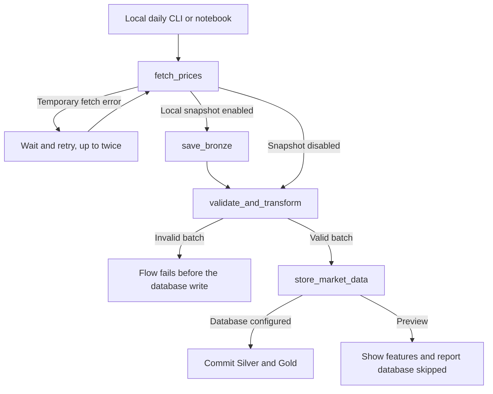
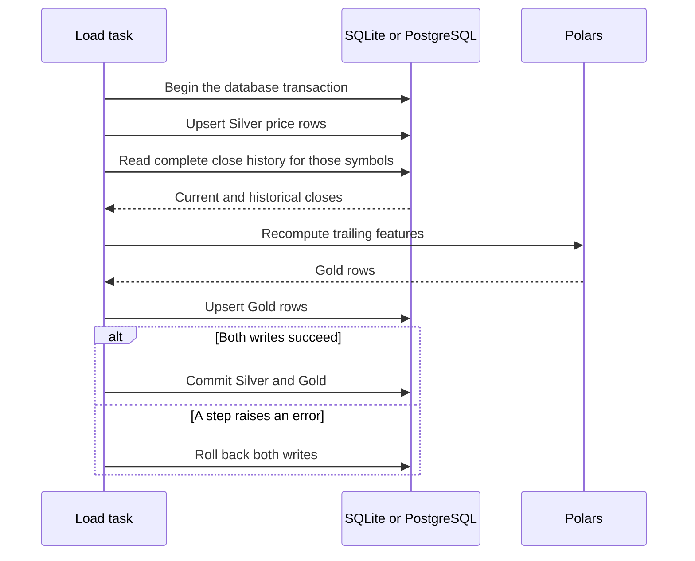
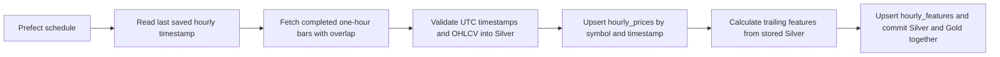

# Architecture

The local lesson runs `historical_ingestion.py` on daily bars and stores them in SQLite. Prefect Cloud runs `hourly_ingestion.py` on completed one-hour bars and stores them in Supabase. Both entrypoints call plain Python functions in `ingestion/`.

| Layer | Responsibility | Location |
| --- | --- | --- |
| Source | One download per Yahoo ticker or a packaged synthetic CSV | `sources.py`, `src/market_data/data/market_sample.csv` |
| Bronze (local lesson) | Preserve provider fields, including adjusted close when present, and attach ticker, source and ingestion time | Local Parquet under `ingest_date=YYYY-MM-DD/symbol=…/` |
| Silver | Validate, sort and retain typed daily OHLCV | `validation.py`, `market_prices` |
| Gold | Calculate daily percent return, trailing means and volatility | `features.py`, `market_features` |

**Why three layers?** Each layer answers a different question. *Bronze:* what exactly did the source send, and when? *Silver:* which rows can we trust, in what types? *Gold:* what does the model or analyst need? Keeping them apart means a bug in a feature never forces you to re-download data, and a bad download never silently reaches a feature.

### Who does what

| Tool | Its job here | Not its job |
| --- | --- | --- |
| **Prefect** (`flows/`) | Order the steps, retry transient fetch errors, record logs and states, run on a schedule | Business rules. A task calls a plain function and logs the result |
| **Polars** (`ingestion/`) | Parse, validate, sort and calculate features in memory | Remembering state between runs |
| **SQLite / PostgreSQL** | Hold Silver and Gold, enforce keys and constraints, and commit both tables together | Calculating features |
| **Parquet files** | Keep each raw Bronze snapshot exactly as received | Serving queries to downstream users |

This split lets you unit-test every rule without Prefect or a database, and swap any one tool without rewriting the others.

The source adapter unwraps pandas' date index and, if present, the requested ticker from a two-level column index. It then hands the data to Polars. Bronze preserves the provider fields after this structural normalization. Polars converts dates to session calendar dates, sorts by symbol and date, and rejects a batch with missing fields, out-of-window dates, invalid OHLCV or duplicate keys. An invalid batch can leave Bronze available for investigation. Silver and Gold for that run are unwritten.

## Read the code in this order

| Read | Follow this part of one fixture run |
| --- | --- |
| 1. [cli.py](../src/market_data/cli.py) | Start at `run_command`. See how source, symbols, dates and database options become flow parameters. |
| 2. [flows/historical_ingestion.py](../src/market_data/flows/historical_ingestion.py) | Start at `ingest_historical_prices`. Read the four task calls at the bottom before reading their bodies. |
| 3. [sources.py](../src/market_data/ingestion/sources.py) | Follow `read_fixture`, then `save_snapshot`. Open `normalize_yahoo` when comparing live data with the fixture. |
| 4. [validation.py](../src/market_data/ingestion/validation.py) | Read `validate_prices` from required fields through type conversion, row checks, and sorting. |
| 5. [features.py](../src/market_data/ingestion/features.py) | Read `build_features` and use `shift(1)` to identify where the previous close comes from. |
| 6. [storage.py](../src/market_data/ingestion/storage.py) and [SQLite schema](../src/market_data/data/sqlite_schema.sql) | Follow `load_market_data` and compare the `ON CONFLICT` key with each primary key. |
| 7. [test_transform.py](../tests/test_transform.py) and [test_idempotency.py](../tests/test_idempotency.py) | Check where warm-up, backfill effects and rollback are asserted. |

## Orchestration and computation

Prefect runs `fetch_prices`, then `validate_and_transform` and `store_market_data`. With Bronze enabled, `save_bronze` runs between fetch and validation. Only the fetch task retries. An empty Yahoo result receives a bounded retry because the library sometimes logs an upstream error and returns an empty frame. Schema or data validation errors fail immediately. The two opt-in failures use the fixture and require `--skip-db`.

Polars computes features using session observations for each symbol. Daily return is `100 × (close / previous_close − 1)`. The 5- and 20-observation moving averages include the current close. Five-observation volatility is the sample standard deviation of daily returns in percentage points. The first return is null, SMA values start at the fifth and twentieth observations, and volatility starts at the sixth observation. Every feature uses current and past closes.

## Storage and repeatability

Both tables in each database use the same `(symbol, trade_date)` primary key. Gold references Silver with a foreign key. The app submits parameterized upserts, so an existing key gets updated and a new key gets inserted. The database protects the key even if a duplicate reaches it from a separate process.

The load task holds one database connection. It writes Silver, reads the stored close history for those symbols, recomputes Gold, and commits both tables together. SQLite uses one writer at a time. PostgreSQL uses per-symbol locks so runs for independent symbols can write concurrently. A short backfill can change a later return or moving average. The full-history rebuild handles this and is easy to follow for daily workshop data. It costs more as history grows. Preview features use only the fetched window, so values near its beginning may differ from Gold stored in the database.

The transaction covers both Silver and Gold in either database. Local Parquet snapshots are written earlier and can survive database failure. PostgreSQL symbol locks coordinate writers using this pipeline. If two successful runs carry different source values for the same key, the later transaction can overwrite the earlier one. This is a latest-value dataset. Rerun timestamps and Bronze filenames change by design.

Local runs keep the optional Parquet snapshot under `BRONZE_DIR`. The hosted configuration fetches fresh Yahoo Finance rows and sends them straight to validation. Silver is its first stored layer. The flow loads the Supabase URI from the Prefect Secret block named in the deployment parameters. To replay the exact original provider response in a later hosted version, add durable object storage for Bronze.

## Hourly follow-up

Start at [`ingest_hourly_gold`](../src/market_data/flows/hourly_ingestion.py), then read [`hourly_window`](../src/market_data/ingestion/hourly.py), [`build_hourly_features`](../src/market_data/ingestion/features.py), and [`load_hourly_prices`](../src/market_data/ingestion/storage.py). Compare the hourly key `(symbol, bar_start_utc)` with the daily key `(symbol, trade_date)`. The hourly moving averages use trailing bars, just as the daily moving averages use trailing sessions.

## Handoff to the ML workshop

The MLOps workshop starts with live hourly Silver and Gold joined on `(symbol, bar_start_utc)`. The [MLOps handoff](MLOPS.md) defines the forecast checkpoint, training target, and time split.
