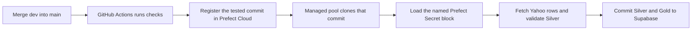

# Deploy the workshop with GitHub, Prefect Cloud, and Supabase

Start with the local notebook. It creates SQLite and lets you inspect Silver and Gold before setting up any cloud accounts. For deployment, GitHub Actions registers the tested code in Prefect Cloud, a Prefect Managed work pool executes it, and Supabase stores the tables.



## 1. Prepare GitHub

Use a repository where you can push branches and configure GitHub Actions. If you are adapting the workshop, fork it or push a copy to your own repository. The workflow derives the clone URL from the repository that runs it.

Create `main` from the original branch if it does not exist, and do your changes on `dev`. In this workshop checkout those branches already exist locally. Check which branches are on your GitHub remote before pushing.

```sh
git remote -v
git branch -avv
git push -u origin main
git push -u origin dev
```

Push changes to `dev` and review the checks there. When Supabase and Prefect are ready, merge a pull request from `dev` into `main`. The push to `main` runs the checks again and, if they pass and deployment is enabled, GitHub Actions registers that commit in Prefect Cloud automatically. Set `main` as the GitHub default branch if you want **Run workflow** available there for manual re-runs. If you're using GitHub CLI and need to sign in, run `gh auth login`.

## 2. Set up Supabase

1. Sign in to the [Supabase Dashboard](https://supabase.com/dashboard). Click **New project**, select your organization, choose a project name and region, set a database password, and click **Create new project**. Save that password privately. You'll need it to complete the connection URI.
2. When the project is ready, open **SQL Editor → New query**. Copy the full contents of [`sql/schema.sql`](../sql/schema.sql) into the editor and click **Run**. It creates `market_data.market_prices`, `market_data.market_features`, and `market_data.hourly_prices`. If you already set up the daily lesson, rerun this file before merging the hourly release; the existing tables and rows are preserved.
3. In the project header, click **Connect**. In the connection string section, select **URI**, then choose **Session pooler**, which works over IPv4. Copy the connection string as shown.
4. Replace the password placeholder with the database password. Percent-encode special characters in the password, such as `@` as `%40` and `#` as `%23`. Preserve the host, port and username from **Connect**.
5. Set `sslmode=require` in the URI. Append `?sslmode=require` when there are no query parameters or `&sslmode=require` when there are existing parameters. If `sslmode` is already set, edit it in place. Paste the completed URI into the Prefect Secret block in the next section.

To check the schema, run this query in Supabase SQL Editor. Both columns should show a table name.

```sql
SELECT to_regclass('market_data.market_prices') AS silver,
       to_regclass('market_data.market_features') AS gold,
       to_regclass('market_data.hourly_prices') AS hourly_silver;
```

[Supabase connection guide](https://supabase.com/docs/guides/database/connecting-to-postgres)

## 3. Set up Prefect Cloud

Create a workspace in Prefect Cloud. Use a separate terminal from the local Prefect lesson. If you saved a localhost `PREFECT_API_URL` or an empty `PREFECT_API_KEY` in the project’s ignored `.env`, comment out those local settings. Prefect reads terminal variables and the project’s `.env` before its saved profile. Clear any local exports before logging in.

```sh
unset PREFECT_API_URL PREFECT_API_KEY PREFECT_SERVER_UI_API_URL
uv run --locked prefect cloud login
uv run --locked prefect config view --show-sources | grep '^PREFECT_API_URL='
```

Select the workspace you will use for the deployment. The effective API URL should start with `https://api.prefect.cloud/api/accounts/`. If it shows localhost, the source printed beside it tells you where to remove the override. After confirming the Cloud URL, create the work pool if it doesn't already exist.

```sh
uv run --locked prefect work-pool create --type prefect:managed market-data-ml
```

Check the workspace in the browser when creating the block and pool. Keep the localhost exports in the terminal you use for the local lesson. [Prefect settings precedence](https://www.prefect.io/docs/v3/concepts/settings-and-profiles)

### Create the Supabase Secret block

1. Open [Prefect Cloud](https://app.prefect.cloud) and select the workspace where the deployment will run.
2. In the sidebar, choose **Blocks → Add Block**. Search for the built-in **Secret** block and select it to open the form. You can also get the form link by running `uv run --locked prefect block create secret` after signing in to the workspace.
3. Enter `market-data-supabase-url` as the **Block Name**. In **Value**, paste the complete `postgresql://…` URI from Supabase, with the password filled in and TLS enabled. Click **Save** or **Create**.
4. Go back to **Blocks** and check that `market-data-supabase-url` appears as a Secret in the same workspace. You can also list block names with `uv run --locked prefect block ls`.
5. Open [`prefect.yaml`](../prefect.yaml). Its `database_secret_block` parameter must match the block's name exactly. The flow uses `Secret.load(block_name).get()` when it needs to read or write Supabase.

Teach **Secret blocks** for credentials such as a database URI. Use **Prefect Variables** for ordinary settings such as a ticker or date range. To rotate the database credential, update the block value and start a new run. [Prefect Secret block reference](https://reference.prefect.io/prefect/blocks/system/#prefect.blocks.system.Secret)

## 4. Connect GitHub Actions to Prefect

In GitHub, go to **Settings → Secrets and variables → Actions**. Use the **Variables** tab for the two variables below and **Secrets → New repository secret** for the key. After signing in with the Prefect CLI, `uv run --locked prefect config view` shows the workspace's `PREFECT_API_URL` to copy. Create the Prefect key in the Cloud UI under your profile's **API Keys**.

| Kind | Name | Value |
| --- | --- | --- |
| Repository variable | `PREFECT_API_URL` | Prefect Cloud workspace API URL ending in `/workspaces/<id>` |
| Repository variable | `ENABLE_PREFECT_DEPLOY` | `true` |
| Repository secret | `PREFECT_API_KEY` | A Prefect Cloud key authorized to register deployments in that workspace |

If you're using your own copy of the project, select your own Prefect Cloud workspace at login and set `PREFECT_API_URL` and `PREFECT_API_KEY` on your GitHub repository. The workspace handle in the UI (for example, `account/default`) helps you confirm where you are. GitHub's `PREFECT_API_URL` takes the full workspace API URL. Create the Secret block using your own Supabase URI. If you choose a different block name or work pool name, update `database_secret_block` or `work_pool.name` in `prefect.yaml` to match.

GitHub uses its API key to register the deployment. At runtime the flow reads the Supabase Secret block from its Prefect workspace.

## 5. Release from `dev` to `main`

1. Confirm that **Work Pools** in Prefect Cloud shows `market-data-ml` (or your own pool name) as a **Prefect Managed** pool and that it is not paused. Prefect runs the flow for you; no terminal or worker needs to stay open.
2. Push to `dev` and let **Verify and deploy → checks** finish. Review and merge a pull request from `dev` into `main`.
3. Open GitHub **Actions → Verify and deploy** and select the new run for `main`. Confirm both **checks** and **deploy** passed. If you enabled deployment after the merge, use **Run workflow** on `main` or push a new commit to `main`.
4. Open **Deployments** in your Prefect workspace. Look for `historical-ingestion/daily-market-data` and `hourly-ingestion/hourly-gold-bars`. Confirm both versions match the commit on `main`.

When a run starts, the managed pool installs the packages listed under `work_pool.job_variables.pip_packages` and clones the exact commit. If you change the project's runtime dependencies, update the matching pins in `prefect.yaml` alongside `uv.lock`. A public repository can be cloned as configured; for a private copy, configure [authenticated code retrieval](https://www.prefect.io/docs/v3/how-to-guides/deployments/store-flow-code).

If your workspace already has `historical-ingestion/workshop-cloud`, keep its schedule paused. Prefect registers the new name as a separate deployment; the old one stays visible with its run history. Point any links or automations you still use at `daily-market-data`.

## 6. Verify one fixture run and one live run

Run these commands from a terminal pointed at the Cloud workspace.

```sh
uv run --locked prefect deployment inspect 'historical-ingestion/daily-market-data'
uv run --locked prefect deployment run 'historical-ingestion/daily-market-data' \
  --params '{"source":"fixture","incremental":false}' --watch
```

Check that the deployment version matches the GitHub commit SHA. The run should log a commit to PostgreSQL. In Supabase SQL Editor, run [the fixture verification queries](../sql/verify.sql) and confirm both tables have 30 fixture rows and 30 distinct keys. The cloud flow skips local Bronze snapshots.

Then try the deployment defaults, which catch up live Yahoo Finance data for `GC=F`.

```sh
uv run --locked prefect deployment run 'historical-ingestion/daily-market-data' --watch
```

In the run log, find the latest stored date and the requested start and end dates. To see the watermark the next run will use, run this in Supabase SQL Editor:

```sql
SELECT symbol, count(*) AS rows, max(trade_date) AS latest_trade_date,
       max(ingested_at) AS latest_write
FROM market_data.market_prices
WHERE symbol = 'GC=F'
GROUP BY symbol;
```

## 7. Understand the daily catch-up

The schedule tells Prefect **when to run**. The data window tells Yahoo Finance **which dates to return**. A default manual run on November 17 uses November 17 UTC as the exclusive end date, so it can ingest November 16's bar if Yahoo has published it. Weekends, market holidays, or a delayed provider can leave the latest trade date earlier. In Supabase, `trade_date` is the market session date; `ingested_at` records when the price row was last written.

In [`prefect.yaml`](../prefect.yaml), `incremental: true` makes every default Cloud run read the last committed trade date per ticker from Supabase. A ticker with no rows starts with the prior 60 calendar days. After that, each run rereads seven calendar days ending on the last committed date, then fetches everything available after it through the same cutoff. For example, if the last stored date is November 13, the November 17 run requests `[November 7, November 17)`. It upserts existing dates and adds any missing sessions through November 16.

For example, if several scheduled runs fail, the saved date stays where it was. When the next run starts, its later cutoff covers the missing sessions. Upserts update overlapping keys, and both tables commit together. Older holes inside already loaded history need a manual backfill. Try the [same recovery with a local fixture](../README.md#practice-catch-up-after-missed-runs).

The daily deployment's recurring schedule stays paused for the hourly trial. It can still be run manually. For a one-off scheduled failure run during class, use the [instructor's Cloud follow-up](INSTRUCTOR_DEMO.md#cloud-follow-up-pr-schedule-and-failure-alert).

## 8. Collect hourly gold bars

The hourly flow fetches one-hour bars for Yahoo's `GC=F` gold futures ticker and writes them to `market_data.hourly_prices`. The key is `(symbol, bar_start_utc)`; multiple bars on the same date are separate rows. The daily Silver and Gold tables are unchanged.

- **Cadence:** `0 */6 * * *` schedules the flow at **00:00, 06:00, 12:00, and 18:00 Africa/Accra**. Each run fetches one-hour bars; the six-hour schedule controls how often it checks for them.
- **Cutoff:** A 12:00 run can store the 11:00 bar because that hour has elapsed. It does not store the 12:00 bar. The flow preserves Yahoo's timestamps, including sessions starting at half past the hour. Market closures or gaps in Yahoo's feed can mean fewer than six new bars.
- **Catch-up:** The first run requests the previous year. Later runs read the newest saved hour, go back one day for revisions, and fetch through the current hour cutoff. Upserts let you rerun the same range safely. An older gap needs an explicit backfill.

You can test offline with SQLite before merging. Run the commands from a terminal configured for [local Prefect](../README.md#prefect-ui-and-local-daily-schedule). The fixture starts at 06:00 UTC on January 6, 2025. Use a fresh file, load through 09:00 exclusive, then let the second run catch up:

```sh
(
  export SQLITE_DB_PATH="$(mktemp -d)/hourly.sqlite3"
  uv run --locked market-data hourly --end-at 2025-01-06T09:00Z
  uv run --locked market-data hourly
  uv run --locked python -c 'import os, sqlite3; db = sqlite3.connect(os.environ["SQLITE_DB_PATH"]); print(db.execute("SELECT count(*), max(bar_start_utc) FROM hourly_prices").fetchone())'
)
```

Expect 3 bars on the first run and 12 distinct bars after the second. In Prefect Cloud, after the merge and schema setup, manually kick off the real backfill or wait for the next scheduled run:

```sh
uv run --locked prefect deployment run 'hourly-ingestion/hourly-gold-bars' --watch
```

To repair an older window, pass both timestamps. For example, for the workshop date:

```sh
uv run --locked prefect deployment run 'hourly-ingestion/hourly-gold-bars' \
  --params '{"start_at":"2026-11-16T12:00:00Z","end_at":"2026-11-17T12:00:00Z"}' --watch
```

Verify the live row count and timestamps in the Supabase SQL Editor:

```sql
SELECT count(*) AS hourly_bars, min(bar_start_utc) AS first_bar,
       max(bar_start_utc) AS latest_bar, max(ingested_at) AS latest_write
FROM market_data.hourly_prices
WHERE symbol = 'GC=F';
```

Pause the hourly schedule in Prefect after the December trial. Also set the hourly schedule's `active` flag to `false` in `prefect.yaml` and merge that change so a future release keeps it paused.

[Yahoo Finance interval and cutoff options](https://ranaroussi.github.io/yfinance/reference/api/yfinance.download.html)

[Prefect Managed work pools](https://www.prefect.io/docs/v3/how-to-guides/deployment_infra/managed) · [Prefect YAML deployments](https://www.prefect.io/docs/v3/how-to-guides/deployments/prefect-yaml)
