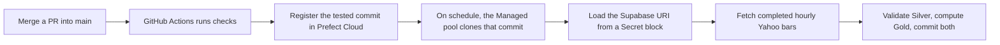
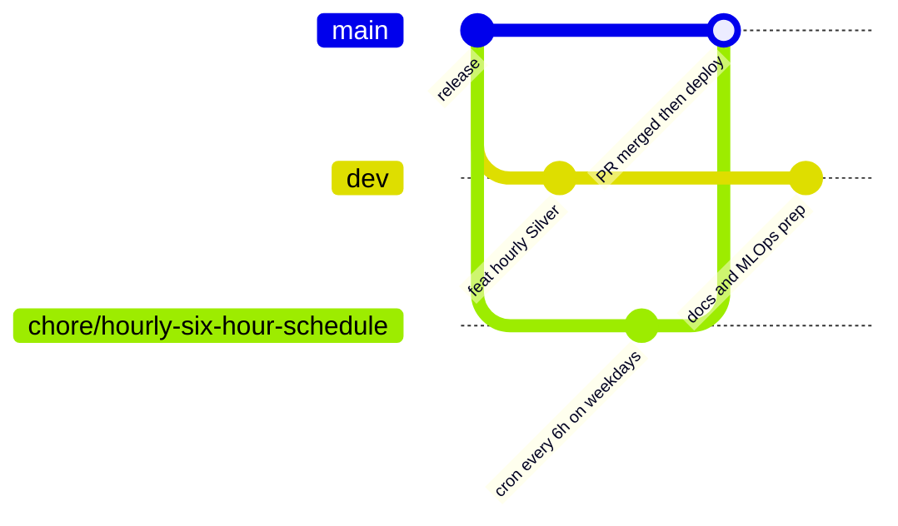

# Deploy the workshop with GitHub, Prefect Cloud, and Supabase

Start with the local notebook. It uses SQLite and lets you inspect daily Silver and Gold before you create any cloud accounts. This guide then puts the **hourly** gold flow into production. GitHub Actions tests and releases it, a Prefect Managed work pool runs it on a schedule, and Supabase stores hourly Silver bars and Gold features.



## Before you start

| You need | Free tier is enough? | Time |
| --- | --- | --- |
| A GitHub repository you can push to and configure (your fork or copy) | Yes | 5 min |
| A [Supabase](https://supabase.com/dashboard) project | Yes | 10 min |
| A [Prefect Cloud](https://app.prefect.cloud) workspace | Yes | 10 min |
| Local checks passing: `uv run --locked ruff check . && uv run --locked pytest` | n/a | 2 min |

### Terminal or UI?

Most steps below show **two routes**. Pick either one; they do the same thing.

- **Terminal**: commands you can copy, repeat and put in a script.
- **UI (ClickOps)**: clicking through the web console. This is easier the first time and good for seeing what exists.

ClickOps is a fine way to *learn*, but it is hard to repeat exactly and leaves no record of who changed what. That is why the deployment itself is defined in a file ([`prefect.yaml`](../prefect.yaml)) and applied by CI. As you get comfortable, move each step from the UI column to the terminal column, and eventually into code.

## 1. How a change reaches production

This repository uses two long-lived branches:

| Branch | Role | What runs |
| --- | --- | --- |
| `dev` | Integration. Day-to-day work lands here | You run lint and tests locally |
| `main` | **Production**. Every commit here is released | CI runs checks, then registers the commit in Prefect Cloud |

Short-lived feature branches (`feat/…`, `fix/…`, `chore/…`) branch off, get reviewed in a pull request, and merge back. Changes reach `main` only through a PR, so every production change has been reviewed and tested.



**Worked example: the schedule change.** The branch `chore/hourly-six-hour-schedule` changes one line in `prefect.yaml`, from `0 6,12 * * *` (06:00 and 12:00 daily) to `0 */6 * * 1-5` (every six hours, Monday to Friday). Opening a PR from it into `main` lets the class watch the full path. Review the diff, watch **checks** pass, merge, watch **deploy**, then confirm the new schedule in Prefect Cloud. Work that isn't ready for production, such as the MLOps preparation, stays on `dev`.

**Terminal**

```sh
git remote -v
git branch -avv
gh pr create --base main --head chore/hourly-six-hour-schedule --fill
```

**UI**: in GitHub, open **Pull requests → New pull request**. Set **base** to `main` and **compare** to your branch. Read the **Files changed** tab, then click **Create pull request**.

If you're adapting the workshop, fork it or push a copy to your own repository. The workflow derives the clone URL from whichever repository runs it. Create `main` from the original branch if it doesn't exist, and do your work on `dev`. Set `main` as the GitHub default branch (**Settings → General → Default branch**) so that **Run workflow** appears in Actions. If you use GitHub CLI and need to sign in, run `gh auth login`.

CI runs on pull requests into `main`, pushes to `main` and manual runs. It does not run on pushes to `dev`, so run the checks locally before you push.

## 2. Set up Supabase

Supabase is UI-first, so these steps use the dashboard.

1. Sign in to the [Supabase Dashboard](https://supabase.com/dashboard). Click **New project**, choose your organization, a name and a region, and set a database password. Save the password privately, because you'll need it for the connection URI. Click **Create new project**.
2. When the project is ready, open **SQL Editor → New query**. Paste the full contents of [`sql/schema.sql`](../sql/schema.sql) and click **Run**. This creates the daily and hourly Silver and Gold tables in a `market_data` schema. The script is safe to rerun. If you set up an earlier version, rerun it to add any new tables or columns, such as the hourly tables or `hourly_prices._rescued_data`.
3. Click **Connect** in the project header. Under connection string, select **URI**, then **Session pooler**, which works over IPv4. Copy the string.
4. Replace the password placeholder with your database password. Percent-encode special characters, for example `@` becomes `%40` and `#` becomes `%23`. Keep the host, port and username exactly as shown.
5. Add `sslmode=require`. Append `?sslmode=require` if the URI has no `?`, or `&sslmode=require` if it already has parameters. You'll paste this URI into Prefect in the next section. Don't save it anywhere in the repository.

**Check:** run this in SQL Editor. Every column should show a table name, not `NULL`.

```sql
SELECT to_regclass('market_data.market_prices') AS silver,
       to_regclass('market_data.market_features') AS gold,
       to_regclass('market_data.hourly_prices') AS hourly_silver,
       to_regclass('market_data.hourly_features') AS hourly_gold;
```

You can also open **Table Editor** and switch the schema dropdown to `market_data`. [Supabase connection guide](https://supabase.com/docs/guides/database/connecting-to-postgres)

## 3. Set up Prefect Cloud

Create a workspace at [app.prefect.cloud](https://app.prefect.cloud). Use a **separate terminal** from the local Prefect lesson. Prefect reads terminal variables and the project's `.env` before your saved profile, so a leftover localhost setting will silently point you at the wrong server. If your `.env` contains a localhost `PREFECT_API_URL` or an empty `PREFECT_API_KEY`, comment those lines out.

**Terminal**

```sh
unset PREFECT_API_URL PREFECT_API_KEY PREFECT_SERVER_UI_API_URL
uv run --locked prefect cloud login
uv run --locked prefect config view --show-sources | grep '^PREFECT_API_URL='
```

Choose your workspace when prompted. The API URL must start with `https://api.prefect.cloud/api/accounts/`. If it shows localhost, the source printed beside it tells you which override to remove. Then create the work pool:

```sh
uv run --locked prefect work-pool create --type prefect:managed market-data-ml
```

**UI**: open **Work Pools** and click **+**. Choose **Prefect Managed**, click **Next**, enter `market-data-ml` as the name, keep the defaults and click **Create**.

A **Prefect Managed** pool means Prefect starts a container for each run and removes it afterwards. You don't keep a terminal or server running. Because the container's disk is temporary, the Cloud flow skips Bronze Parquet. [Prefect settings precedence](https://www.prefect.io/docs/v3/concepts/settings-and-profiles)

### Create the Supabase Secret block

1. In [Prefect Cloud](https://app.prefect.cloud), select the workspace where the deployment will run.
2. Open **Blocks** and click **+** (Add Block). Search for **Secret** and select it. From the terminal, `uv run --locked prefect block create secret` prints a link to the same form.
3. Enter `market-data-supabase-url` as the **Block Name**. In **Value**, paste the complete `postgresql://…` URI with the password filled in and `sslmode=require`. Click **Create**.
4. Check that `market-data-supabase-url` appears under **Blocks**, or run `uv run --locked prefect block ls`.
5. In [`prefect.yaml`](../prefect.yaml), `database_secret_block` must match the block name exactly. The flow calls `Secret.load(block_name).get()` only when it needs the database.

Use **Secret blocks** for credentials and **Prefect Variables** for ordinary settings such as a ticker. To rotate the password, update the block's value and start a new run. You don't need to change any code. [Secret block reference](https://reference.prefect.io/prefect/blocks/system/#prefect.blocks.system.Secret)

## 4. Connect GitHub Actions to Prefect

GitHub needs two things: where your workspace is (`PREFECT_API_URL`) and permission to deploy into it (`PREFECT_API_KEY`).

| Kind | Name | Value |
| --- | --- | --- |
| Repository **variable** | `PREFECT_API_URL` | `https://api.prefect.cloud/api/accounts/<account-id>/workspaces/<workspace-id>` |
| Repository **variable** | `ENABLE_PREFECT_DEPLOY` | `true` |
| Repository **secret** | `PREFECT_API_KEY` | A Prefect Cloud API key for that workspace |

**Find the values**

- *Terminal:* after `prefect cloud login`, run `uv run --locked prefect config view` and copy `PREFECT_API_URL`.
- *UI:* open your workspace in the browser. The address bar shows `app.prefect.cloud/account/<account-id>/workspace/<workspace-id>/…`. Put those two IDs into the URL pattern above.
- *API key:* click your profile avatar, open **API keys**, click **+**, give the key a name and an expiry date, and copy it immediately. Prefect shows it only once.

**Save them**

- *Terminal:*

  ```sh
  gh variable set PREFECT_API_URL --body 'https://api.prefect.cloud/api/accounts/…/workspaces/…'
  gh variable set ENABLE_PREFECT_DEPLOY --body true
  gh secret set PREFECT_API_KEY
  ```

  `gh secret set` prompts for the value, so it doesn't end up in your shell history.
- *UI:* in GitHub, open **Settings → Secrets and variables → Actions**. Add the two variables on the **Variables** tab and the key with **Secrets → New repository secret**.

If you use a different block name or pool name, update `database_secret_block` or `work_pool.name` in `prefect.yaml` to match. GitHub uses its key only to *register* the deployment. At run time the flow reads the Supabase URI from the Secret block in Prefect. See [SECURITY.md](SECURITY.md) for why the secrets are split this way.

## 5. Release to `main`

1. In Prefect Cloud, confirm **Work Pools** shows `market-data-ml` as **Prefect Managed** and not paused.
2. Open a PR into `main` (see [§1](#1-how-a-change-reaches-production)) and wait for **Verify and deploy → checks** to pass. Merge it.
3. In GitHub, open **Actions → Verify and deploy** and select the new run on `main`. Both **checks** and **deploy** should be green. If you enabled deployment after merging, click **Run workflow** on `main` (UI) or run `gh workflow run ci.yml --ref main` (terminal).
4. In Prefect Cloud, open **Deployments** and find `hourly-ingestion/hourly-gold-bars`. Its **version** should equal the commit SHA on `main`.

At run time the Managed pool installs the `pip_packages` listed in `prefect.yaml` and then clones the exact commit. If you change a runtime dependency, update those pins together with `uv.lock`. [`test_deployment.py`](../tests/test_deployment.py) fails if they differ. A public repository can be cloned as configured. For a private copy, configure [authenticated code retrieval](https://www.prefect.io/docs/v3/how-to-guides/deployments/store-flow-code).

Changing `prefect.yaml` does not delete deployments registered earlier. If your workspace still has `historical-ingestion/workshop-cloud`, pause its schedule, verify the hourly run, then delete the old deployment from **Deployments**. Deleting a deployment doesn't touch the tables in Supabase.

## 6. Verify the Cloud deployment

Start with a **fixture preview**. It runs the deployed code in Prefect's infrastructure without writing synthetic bars to Supabase.

**Terminal**

```sh
uv run --locked prefect deployment inspect 'hourly-ingestion/hourly-gold-bars'
uv run --locked prefect deployment run 'hourly-ingestion/hourly-gold-bars' \
  --params '{"source":"fixture","skip_db":true,"require_db":false,"database_secret_block":null}' --watch
```

**UI**: open **Deployments → hourly-gold-bars**. Check the version, schedule, work pool and default parameters on the details panel. Open the **Run** menu, choose **Custom run**, and set `source` to `fixture`, `skip_db` to on, `require_db` to off and `database_secret_block` to empty. Submit, then open the run and select **Logs**.

Expect 12 hourly Silver bars and 12 Gold preview rows in the logs. A **Quick run** uses the default parameters, so it performs a real Yahoo-to-Supabase load.

## 7. Collect hourly gold bars

The hourly flow fetches one-hour bars for Yahoo's `GC=F` gold futures ticker. It writes validated bars to Silver (`market_data.hourly_prices`) and trailing features to Gold (`market_data.hourly_features`). Both tables use `(symbol, bar_start_utc)` as the key. If hourly Silver is empty, the first run backfills one year.

- **Cadence:** `0 6,12 * * *` runs at **06:00 and 12:00 Africa/Accra**. After the [schedule PR](#1-how-a-change-reaches-production) merges, `0 */6 * * 1-5` runs at 00:00, 06:00, 12:00 and 18:00, Monday to Friday.
- **Cutoff:** a 12:00 run stores the bar that *started* at 11:00, because that hour has finished. It doesn't store the 12:00 bar, which is still open. Yahoo's own timestamps are kept, including sessions that start at half past the hour. Market closures or feed gaps can mean fewer than six new bars.
- **Catch-up:** later runs read the newest stored bar, go back 24 hours to pick up revisions, and fetch up to the cutoff. Upserts make reruns safe. An older gap needs an explicit backfill, shown below.

Gold holds the percent return from the previous bar, 5- and 20-bar moving averages, and sample volatility over the last five returns. Windows count *observed* bars, so one window can span a market closure. The flow rebuilds Gold from stored Silver, so a revised bar also updates the later features that depend on it. Silver and Gold commit in one transaction.

### Rehearse offline first

Run these from a terminal configured for [local Prefect](../README.md#prefect-ui-and-local-daily-schedule). The hourly fixture starts at 06:00 UTC on January 6, 2025. Load through 09:00, then let the second run catch up:

```sh
(
  export SQLITE_DB_PATH="$(mktemp -d)/hourly.sqlite3"
  uv run --locked market-data hourly --end-at 2025-01-06T09:00Z
  uv run --locked market-data hourly
  uv run --locked python -c 'import os, sqlite3; db = sqlite3.connect(os.environ["SQLITE_DB_PATH"]); print(db.execute("SELECT (SELECT count(*) FROM hourly_prices), (SELECT count(*) FROM hourly_features)").fetchone())'
)
```

Expect 3 Silver and 3 Gold rows after the first run, then `(12, 12)`. To test against Supabase from your laptop before merging, put the URI in `DATABASE_URL` in `.env` and run `uv run market-data hourly --source yfinance --require-db`.

### Start the real load

After the merge and schema setup, start the first backfill instead of waiting for the schedule. Use **Quick run** in the UI, or:

```sh
uv run --locked prefect deployment run 'hourly-ingestion/hourly-gold-bars' --watch
```

To replay an older window without deleting rows, pass both timestamps. The flow uses that window instead of the stored watermark and upserts matching keys:

```sh
uv run --locked prefect deployment run 'hourly-ingestion/hourly-gold-bars' \
  --params '{"start_at":"2026-11-10T06:00:00Z","end_at":"2026-11-11T06:00:00Z"}' --watch
```

In the UI, use **Run → Custom run** and fill in `start_at` and `end_at`.

Check the result in Supabase SQL Editor:

```sql
SELECT count(*) AS silver_bars, count(f.bar_start_utc) AS gold_rows,
       min(p.bar_start_utc) AS first_bar, max(p.bar_start_utc) AS latest_bar
FROM market_data.hourly_prices AS p
LEFT JOIN market_data.hourly_features AS f USING (symbol, bar_start_utc)
WHERE p.symbol = 'GC=F';
```

`silver_bars` and `gold_rows` should be equal, and `latest_bar` should be within a few hours of now on a trading day.

### Pause and resume between sessions

**UI**: open **Deployments → hourly-gold-bars** and toggle the schedule.

**Terminal** (Cloud profile):

```sh
uv run --locked prefect deployment schedule pause 'hourly-ingestion/hourly-gold-bars' --all
uv run --locked prefect deployment schedule resume 'hourly-ingestion/hourly-gold-bars' --all
```

You can still start a manual run while the schedule is paused. When you resume, the next run catches up from 24 hours before the last stored bar. For example, after a pause from Thursday to Tuesday, it fetches the available Friday, Sunday-evening and Monday bars. A release re-applies the `active` value from `prefect.yaml`, so check the schedule after each deploy. To keep it paused across releases, set `active: false` in `prefect.yaml` and merge that change.

> **Instructor note:** pause the hourly schedule after the December trial so the free tiers aren't used between cohorts.

## Release checklist

- [ ] `sql/schema.sql` has been run in the Supabase project the URI points to
- [ ] Secret block `market-data-supabase-url` exists in the same Prefect workspace as the deployment
- [ ] Work pool `market-data-ml` is Prefect Managed and not paused
- [ ] GitHub has `PREFECT_API_URL` and `ENABLE_PREFECT_DEPLOY` variables and the `PREFECT_API_KEY` secret
- [ ] The PR into `main` passed **checks**, and after merging **deploy** is green
- [ ] The deployment version in Prefect matches the commit SHA on `main`
- [ ] The fixture preview run shows 12 Silver and 12 Gold rows
- [ ] A live run fills `hourly_prices` and `hourly_features` with equal counts

If something fails, see [Troubleshooting](TROUBLESHOOTING.md).

[Yahoo Finance interval and cutoff options](https://ranaroussi.github.io/yfinance/reference/api/yfinance.download.html) · [Prefect Managed work pools](https://www.prefect.io/docs/v3/how-to-guides/deployment_infra/managed) · [Prefect YAML deployments](https://www.prefect.io/docs/v3/how-to-guides/deployments/prefect-yaml)
