# Deploy the workshop with GitHub, Prefect Cloud, and Supabase

Start with the local notebook. It creates SQLite and lets you inspect daily Silver and Gold before setting up any cloud accounts. GitHub Actions releases the hourly gold ingestion flow to Prefect Cloud. A Prefect Managed work pool runs it and Supabase stores hourly Silver bars and Gold features.

```mermaid
flowchart LR
    A["Merge a release PR into main"] --> B["GitHub Actions runs checks"]
    B --> C["Register the tested commit in Prefect Cloud"]
    C --> D["Managed pool clones that commit"]
    D --> E["Load the named Prefect Secret block"]
    E --> F["Fetch completed hourly Yahoo bars"]
    F --> G["Validate Silver hourly prices"]
    G --> H["Compute Gold features and commit both tables"]
```



## 1. Prepare GitHub

Use a repository where you can push branches and configure GitHub Actions. If you are adapting the workshop, fork it or push a copy to your own repository. The workflow derives the clone URL from the repository that runs it.

Create `main` from the original branch if it does not exist, and do your changes on `dev`. In this workshop checkout those branches already exist locally. Check which branches are on your GitHub remote before pushing.

```sh
git remote -v
git branch -avv
```

Run lint and tests locally before pushing development changes to `dev`. This version of the workflow runs CI on pull requests into `main`, pushes to `main`, and manual runs. When you are ready to release, merge a PR into `main`. If the checks pass and deployment is enabled, GitHub Actions registers that commit in Prefect Cloud. Set `main` as the GitHub default branch to expose **Run workflow**. If you're using GitHub CLI and need to sign in, run `gh auth login`.

## 2. Set up Supabase

1. Sign in to the [Supabase Dashboard](https://supabase.com/dashboard). Click **New project**, select your organization, choose a project name and region, set a database password, and click **Create new project**. Save that password privately. You'll need it to complete the connection URI.
2. When the project is ready, open **SQL Editor → New query**. Copy the full contents of [`sql/schema.sql`](../sql/schema.sql) into the editor and click **Run**. It creates the daily and hourly Silver and Gold tables. If you already set up the daily lesson, rerun this file before merging the hourly release to add the hourly tables.
3. In the project header, click **Connect**. In the connection string section, select **URI**, then choose **Session pooler**, which works over IPv4. Copy the connection string as shown.
4. Replace the password placeholder with the database password. Percent-encode special characters in the password, such as `@` as `%40` and `#` as `%23`. Preserve the host, port and username from **Connect**.
5. Set `sslmode=require` in the URI. Append `?sslmode=require` when there are no query parameters or `&sslmode=require` when there are existing parameters. If `sslmode` is already set, edit it in place. Paste the completed URI into the Prefect Secret block in the next section.

To check the schema, run this query in Supabase SQL Editor. Each column should show a table name.

```sql
SELECT to_regclass('market_data.market_prices') AS silver,
       to_regclass('market_data.market_features') AS gold,
       to_regclass('market_data.hourly_prices') AS hourly_silver,
       to_regclass('market_data.hourly_features') AS hourly_gold;
```

[Supabase connection guide](https://supabase.com/docs/guides/database/connecting-to-postgres)

## 3. Set up Prefect Cloud

Create a workspace in Prefect Cloud. Use a separate terminal from the local Prefect lesson. If you saved a localhost `PREFECT_API_URL` or an empty `PREFECT_API_KEY` in the project’s ignored `.env`, comment out those local settings. Prefect reads terminal variables and the project’s `.env` before its saved profile. Clear any local exports before logging in.

```sh
unset PREFECT_API_URL PREFECT_API_KEY PREFECT_SERVER_UI_API_URL
uv run --locked prefect cloud login
uv run --locked prefect config view --show-sources | grep '^PREFECT_API_URL='
```

Select the workspace you will use for the deployment. The effective API URL should start with `https://api.prefect.cloud/api/accounts/`. If it shows localhost, the source printed beside it tells you where to remove the override. After confirming the Cloud URL, create the work pool if it doesn't already exist.

```sh
uv run --locked prefect work-pool create --type prefect:managed market-data-ml
```

Check the workspace in the browser when creating the block and pool. Keep the localhost exports in the terminal you use for the local lesson. [Prefect settings precedence](https://www.prefect.io/docs/v3/concepts/settings-and-profiles)

### Create the Supabase Secret block

1. Open [Prefect Cloud](https://app.prefect.cloud) and select the workspace where the deployment will run.
2. In the sidebar, choose **Blocks → Add Block**. Search for the built-in **Secret** block and select it to open the form. You can also get the form link by running `uv run --locked prefect block create secret` after signing in to the workspace.
3. Enter `market-data-supabase-url` as the **Block Name**. In **Value**, paste the complete `postgresql://…` URI from Supabase, with the password filled in and TLS enabled. Click **Save** or **Create**.
4. Go back to **Blocks** and check that `market-data-supabase-url` appears as a Secret in the same workspace. You can also list block names with `uv run --locked prefect block ls`.
5. Open [`prefect.yaml`](../prefect.yaml). Its `database_secret_block` parameter must match the block's name exactly. The flow uses `Secret.load(block_name).get()` when it needs to read or write Supabase.

Teach **Secret blocks** for credentials such as a database URI. Use **Prefect Variables** for ordinary settings such as a ticker or date range. To rotate the database credential, update the block value and start a new run. [Prefect Secret block reference](https://reference.prefect.io/prefect/blocks/system/#prefect.blocks.system.Secret)

## 4. Connect GitHub Actions to Prefect

In GitHub, go to **Settings → Secrets and variables → Actions**. Use the **Variables** tab for the two variables below and **Secrets → New repository secret** for the key. After signing in with the Prefect CLI, `uv run --locked prefect config view` shows the workspace's `PREFECT_API_URL` to copy. Create the Prefect key in the Cloud UI under your profile's **API Keys**.

| Kind | Name | Value |
| --- | --- | --- |
| Repository variable | `PREFECT_API_URL` | Prefect Cloud workspace API URL ending in `/workspaces/<id>` |
| Repository variable | `ENABLE_PREFECT_DEPLOY` | `true` |
| Repository secret | `PREFECT_API_KEY` | A Prefect Cloud key authorized to register deployments in that workspace |

If you're using your own copy of the project, select your own Prefect Cloud workspace at login and set `PREFECT_API_URL` and `PREFECT_API_KEY` on your GitHub repository. The workspace handle in the UI (for example, `account/default`) helps you confirm where you are. GitHub's `PREFECT_API_URL` takes the full workspace API URL. Create the Secret block using your own Supabase URI. If you choose a different block name or work pool name, update `database_secret_block` or `work_pool.name` in `prefect.yaml` to match.

GitHub uses its API key to register the deployment. At runtime the flow reads the Supabase Secret block from its Prefect workspace.

## 5. Release to `main`

1. Confirm that **Work Pools** in Prefect Cloud shows `market-data-ml` (or your own pool name) as a **Prefect Managed** pool and that it is not paused. Prefect runs the flow for you; no terminal or worker needs to stay open.
2. Open a release PR into `main` and let **Verify and deploy → checks** finish. For the schedule demo, merge the dedicated schedule PR. Keep the MLOps preparation on `dev` until its own release.
3. Open GitHub **Actions → Verify and deploy** and select the new run for `main`. Confirm both **checks** and **deploy** passed. If you enabled deployment after the merge, use **Run workflow** on `main` or push a new commit to `main`.
4. Open **Deployments** in your Prefect workspace. Find `hourly-ingestion/hourly-gold-bars` and confirm its version matches the commit on `main`. The daily flow is still available locally through the notebook and `market-data serve`.

When a run starts, the managed pool installs the packages listed under `work_pool.job_variables.pip_packages` and clones the exact commit. If you change the project's runtime dependencies, update the matching pins in `prefect.yaml` alongside `uv.lock`. A public repository can be cloned as configured; for a private copy, configure [authenticated code retrieval](https://www.prefect.io/docs/v3/how-to-guides/deployments/store-flow-code).

If your workspace already has `historical-ingestion/workshop-cloud`, leave its schedule paused during the switch. Changing `prefect.yaml` does not remove a previously registered deployment. After verifying the hourly run, you can remove the old daily deployment from **Deployments** in Prefect to free its slot. This does not remove the daily tables in Supabase.

## 6. Verify the Cloud deployment

Run these commands from a terminal pointed at the Cloud workspace. The fixture preview checks the deployed flow without writing synthetic bars to Supabase.

```sh
uv run --locked prefect deployment inspect 'hourly-ingestion/hourly-gold-bars'
uv run --locked prefect deployment run 'hourly-ingestion/hourly-gold-bars' \
  --params '{"source":"fixture","skip_db":true,"require_db":false,"database_secret_block":null}' --watch
```

Confirm the version matches the commit on `main` and the preview logs show 12 hourly Silver bars and 12 Gold feature rows. Use the live run below to verify the database connection and load real bars.

## 7. Collect hourly gold bars

The hourly flow fetches one-hour bars for Yahoo's `GC=F` gold futures ticker. It writes validated bars to Silver (`market_data.hourly_prices`) and trailing features to Gold (`market_data.hourly_features`). Both use `(symbol, bar_start_utc)` as the key. An empty hourly Silver table starts a one-year backfill for `GC=F`.

- **Cadence.** `0 6,12 * * *` schedules the flow at **06:00 and 12:00 Africa/Accra**. Each run fetches completed one-hour bars.
- **Cutoff:** A 12:00 run can store the 11:00 bar because that hour has elapsed. It does not store the 12:00 bar. The flow preserves Yahoo's timestamps, including sessions starting at half past the hour. Market closures or gaps in Yahoo's feed can mean fewer than six new bars.
- **Catch-up:** The first run requests the previous year. Later runs read the newest saved hour, go back one day for revisions, and fetch through the current hour cutoff. Upserts let you rerun the same range safely. An older gap needs an explicit backfill.

Gold contains percent return from the previous observed bar, 5- and 20-bar moving averages, and sample volatility over the last five returns. These windows count observed bars, so a window can span a market closure. The flow rebuilds Gold from stored Silver history so a revised bar also updates any later features it affects. Both tables commit in one transaction.

You can test offline with SQLite before merging. Run the commands from a terminal configured for [local Prefect](../README.md#prefect-ui-and-local-daily-schedule). The fixture starts at 06:00 UTC on January 6, 2025. Use a fresh file, load through 09:00 exclusive, then let the second run catch up:

```sh
(
  export SQLITE_DB_PATH="$(mktemp -d)/hourly.sqlite3"
  uv run --locked market-data hourly --end-at 2025-01-06T09:00Z
  uv run --locked market-data hourly
  uv run --locked python -c 'import os, sqlite3; db = sqlite3.connect(os.environ["SQLITE_DB_PATH"]); print(db.execute("SELECT (SELECT count(*) FROM hourly_prices), (SELECT count(*) FROM hourly_features)").fetchone())'
)
```

Expect 3 Silver and 3 Gold rows after the first run, then 12 of each after the second. In Prefect Cloud, after the merge and schema setup, manually kick off the real backfill or wait for the next scheduled run:

```sh
uv run --locked prefect deployment run 'hourly-ingestion/hourly-gold-bars' --watch
```

To replay an older window without deleting any rows, pass both timestamps. The flow uses that explicit window instead of the watermark and upserts matching keys. This example replays a completed day before class:

```sh
uv run --locked prefect deployment run 'hourly-ingestion/hourly-gold-bars' \
  --params '{"start_at":"2026-11-10T06:00:00Z","end_at":"2026-11-11T06:00:00Z"}' --watch
```

Verify the live row count and timestamps in the Supabase SQL Editor:

```sql
SELECT count(*) AS silver_bars, count(f.bar_start_utc) AS gold_rows,
       min(p.bar_start_utc) AS first_bar, max(p.bar_start_utc) AS latest_bar
FROM market_data.hourly_prices AS p
LEFT JOIN market_data.hourly_features AS f USING (symbol, bar_start_utc)
WHERE p.symbol = 'GC=F';
```

Pause the hourly schedule in Prefect after the December trial. Also set the hourly schedule's `active` flag to `false` in `prefect.yaml` and merge that change so a future release keeps it paused.

### Pause and resume between sessions

In Prefect Cloud, open **Deployments → hourly-gold-bars → Schedules** and toggle the schedule. From a terminal using the Cloud profile, you can also run:

```sh
uv run --locked prefect deployment schedule pause 'hourly-ingestion/hourly-gold-bars' --all
uv run --locked prefect deployment schedule resume 'hourly-ingestion/hourly-gold-bars' --all
```

Resume before the next Accra checkpoint you want to observe. The following run catches up from the latest saved bar. You can start a manual run while the schedule is paused. A release reapplies the `active` value in `prefect.yaml`, so check the schedule after deploying.

[Yahoo Finance interval and cutoff options](https://ranaroussi.github.io/yfinance/reference/api/yfinance.download.html)

[Prefect Managed work pools](https://www.prefect.io/docs/v3/how-to-guides/deployment_infra/managed) · [Prefect YAML deployments](https://www.prefect.io/docs/v3/how-to-guides/deployments/prefect-yaml)
