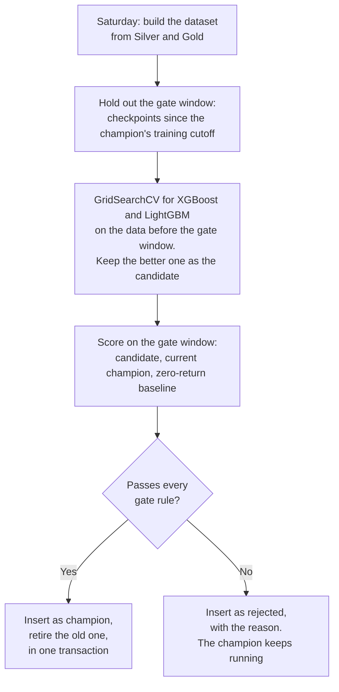
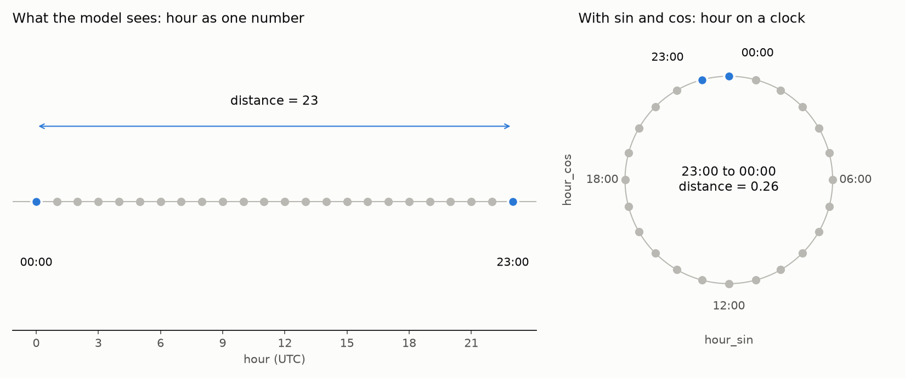
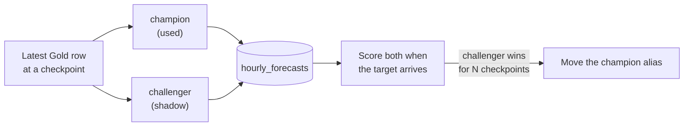

# MLOps kickoff

The local notebook teaches ingestion with a synthetic daily fixture. The MLOps lessons use live `GC=F` gold futures bars from the hourly Prefect Cloud deployment:

- **Silver** (`market_data.hourly_prices`) holds completed one-hour bars.
- **Gold** (`market_data.hourly_features`) holds trailing returns, moving averages and volatility.
- Both tables join on `(symbol, bar_start_utc)`.

## The production rhythm we are building towards

| Every weekday at (Africa/Accra = UTC) | Flow | Status |
| --- | --- | --- |
| 00:00, 06:00, 12:00, 18:00 | `hourly-ingestion` loads completed bars into Silver and Gold | Built. The [schedule PR](DEPLOYMENT.md#1-how-a-change-reaches-production) switches it from 06:00 and 12:00 daily to this cadence |
| About 15 minutes later | A prediction flow loads the current champion model, reads the latest Gold row and forecasts the next six hours | MLOps sessions |
| Six hours after each forecast | A scoring step stores the actual return next to the forecast | MLOps sessions |
| Saturday 02:00 (`0 2 * * 6`), market closed | A training flow tunes XGBoost and LightGBM, keeps the better one, and sends it through the [production gate](#the-production-gate) | MLOps sessions |

The 15-minute gap gives ingestion time to finish. A sturdier design triggers the prediction flow when ingestion **completes**, using a Prefect automation or a deployment trigger, instead of guessing a delay. Comparing the two designs makes a good class discussion.

## Start with a read-only query

In Supabase **SQL Editor**:

```sql
SELECT p.bar_start_utc,
       p.bar_start_utc + interval '1 hour' AS bar_end_utc,
       p.close, f.hourly_return, f.sma_5, f.sma_20, f.volatility_5
FROM market_data.hourly_prices AS p
JOIN market_data.hourly_features AS f USING (symbol, bar_start_utc)
WHERE p.symbol = 'GC=F' AND p.source = 'yfinance'
ORDER BY p.bar_start_utc DESC
LIMIT 12;
```

## What is known at a checkpoint?

Use the query to discuss **point-in-time correctness**. At the 12:00 checkpoint, the bar that started at 11:00 has closed and been ingested, so its features may be used. For a six-hour forecast, the target is the return from that close to the close of the bar ending at 18:00. Anything after 12:00 is the future and must not leak into the features.

Historical training examples need both an eligible input bar and the exact target bar. Skip examples whose target is missing because of a market closure or a feed gap. For example, gold futures pause daily and close from Friday evening to Sunday evening.

## First modelling steps

1. Build one example per checkpoint from a **fixed snapshot** of the hourly tables. Record the query, the data window and the snapshot date. The live tables can change as Yahoo revises bars.
2. Split examples **chronologically**, never randomly, and leave a six-hour gap at the split so training targets don't overlap the test period. Compare the first model against a zero-return baseline.
3. Record the feature columns, target, split, model version and test metrics. Use the same feature code at training and prediction time.

## Where the model lives: local vs production

In class we use MLflow the way most tutorials do. In production we copy MLflow's ideas into Supabase, because a Prefect Managed worker has no MLflow server and its disk disappears after each run. This is the same reason the Cloud ingestion flow skips Bronze.

| | Local, in class | Production, in Prefect Cloud |
| --- | --- | --- |
| Experiment tracking | MLflow with a SQLite backend (`mlflow.db`) and a local artifacts folder | One row per training run in `market_data.model_registry` |
| What is saved | The MLflow model, its parameters and metrics | The **trained model as JSON**, plus hyperparameters, feature list, metrics and git commit |
| Which model runs | The MLflow alias `champion` | The row whose `status` is `champion` |
| Who promotes | You, after comparing runs in the MLflow UI | The weekly training flow, through the production gate |
| Training cadence | When you run the notebook | Weekly, on Saturday |

**Why save the trained model and not just the parameters?** Hyperparameters such as `max_depth=4` are the *recipe*. The trained trees are the *result*. With only the recipe, the prediction flow would have to retrain every six hours, and it might get a slightly different model each time. Both libraries can save a trained model as text: XGBoost as JSON (`model.get_booster().save_raw("json")`) and LightGBM as a model string (`model.booster_.model_to_string()`). A few hundred shallow trees fit comfortably in a `text` column. The prediction flow loads that exact model, so you **deploy exactly what you tested**.

A sketch of the table, to finish in class:

```sql
CREATE TABLE IF NOT EXISTS market_data.model_registry (
    model_id bigserial PRIMARY KEY,
    model_name text NOT NULL,                -- the forecast, for example 'gc_6h_return'
    model_family text NOT NULL CHECK (model_family IN ('xgboost', 'lightgbm')),
    trained_at timestamptz NOT NULL DEFAULT now(),
    train_start_utc timestamptz NOT NULL,    -- the data the model learned from
    train_end_utc timestamptz NOT NULL,
    gate_start_utc timestamptz NOT NULL,     -- the window the gate scored it on
    feature_columns jsonb NOT NULL,          -- order matters at prediction time
    hyperparameters jsonb NOT NULL,          -- the winner of the grid search
    metrics jsonb NOT NULL,                  -- cv, candidate, champion and baseline MAE
    model_text text NOT NULL,                -- the trained model, saved by its library
    library_version text NOT NULL,           -- load with the same version
    code_revision text NOT NULL,             -- git commit of the training code
    status text NOT NULL CHECK (status IN ('champion', 'rejected', 'retired')),
    decision text NOT NULL                   -- why the gate accepted or rejected it
);

-- The database itself guarantees there is never more than one champion.
CREATE UNIQUE INDEX IF NOT EXISTS one_champion_per_model
    ON market_data.model_registry (model_name) WHERE status = 'champion';
```

Rejected models stay in the table. A record of what *didn't* ship is as useful as the record of what did. Every column maps to an MLflow idea: a run (row), params (`hyperparameters`), metrics (`metrics`), an artifact (`model_text`), a registry alias (`status`). Students who understand this table understand the MLflow Model Registry.

## The production gate

A new model goes to production only if it is **measurably better** than the model already running. Otherwise every weekly retrain would swap models on noise.



**The gate rules.** Keep them few and write them down:

1. **Fair comparison.** Score the candidate and the current champion on the **same** checkpoints, ones that *neither* model trained on. The champion was trained up to its own cutoff, so the gate window starts there.
2. **Beat the baseline.** The candidate's mean absolute error must be lower than always predicting a zero return.
3. **Beat the champion by a margin**, for example 2 % lower MAE. A tiny win on one noisy week isn't evidence. On the first run there is no champion, so rule 2 decides alone.
4. **Sanity checks.** Enough gate examples (for example at least 15 checkpoints), no missing predictions, and the same feature columns that the prediction flow will send.

### Tune two models, pick one

Run the **same** search on both libraries, so the comparison is fair: the same features, the same folds and the same metric. Eight combinations each keeps it fast and easy to read.

| | XGBoost grid | LightGBM grid |
| --- | --- | --- |
| Tree size | `max_depth`: 2, 4 | `num_leaves`: 7, 15 |
| Step size | `learning_rate`: 0.03, 0.1 | `learning_rate`: 0.03, 0.1 |
| Number of trees | `n_estimators`: 200, 400 | `n_estimators`: 200, 400 |

XGBoost limits tree **depth**. LightGBM grows trees leaf by leaf, so it limits the number of **leaves** instead. A depth-3 tree has at most 8 leaves, so the two grids cover similar sizes.

```python
folds = TimeSeriesSplit(n_splits=4, gap=1)  # gap: rows inside one six-hour target
searches = {
    "xgboost": GridSearchCV(XGBRegressor(), xgb_grid, cv=folds,
                            scoring="neg_mean_absolute_error"),
    "lightgbm": GridSearchCV(LGBMRegressor(verbose=-1), lgbm_grid, cv=folds,
                             scoring="neg_mean_absolute_error"),
}
for search in searches.values():
    search.fit(X_train, y_train)
```

Set `gap` to the number of rows that fit inside one six-hour target, so a training label never overlaps the validation fold. That is 1 with one row per six-hour checkpoint, or 6 if you build a row every hour.

Then compare the two winners in one table:

| Model | CV MAE (± spread across folds) | RMSE | Direction hit rate | Fit time | vs zero baseline |
| --- | --- | --- | --- | --- | --- |
| Zero-return baseline | … | … | n/a | 0 s | — |
| XGBoost, best settings | … | … | … | … | … |
| LightGBM, best settings | … | … | … | … | … |

Pick the lower MAE. If the two are within one standard deviation of each other, the difference is probably noise, so prefer the faster or simpler model. The weekly production flow runs the same comparison, so the champion can switch from one library to the other over time.

**Rollback** is two small updates in one transaction: retire the current champion, then set the previous model back to `champion`. The unique index forces that order. The next prediction run picks it up.

**Honest caveat for class:** a week of checkpoints is a small sample, so this gate will sometimes keep a model that is really worse, or reject one that is really better. Real teams use longer windows, statistical tests, or a shadow period. See [deployment strategies](#deployment-strategies). The point here is the habit: **no model reaches production without being compared with the one already there.**

## Features to try

Keep the list short. A small set of features you can explain beats fifty you can't. Every feature uses only the current and earlier bars, and every one is a **ratio or a return**, not a raw price. Tree models such as XGBoost and LightGBM can't extrapolate, so a model trained when gold was 2,000 has never seen a raw price of 3,000. A ratio means the same thing at any price level.

| Feature | How | Why it might help | In Gold today? |
| --- | --- | --- | --- |
| Last return | `hourly_return` | The most recent move | ✅ |
| Lagged returns | returns 2, 3 and 6 bars ago | Do moves continue or reverse? | Add |
| Momentum | return over the last 6 bars | Same length as the forecast horizon | Add |
| Distance from trend | `close / sma_20 − 1` | How stretched the price is from its recent average | Add, from the existing `sma_20` |
| Volatility | `volatility_5`, plus a 20-bar version | Big moves cluster together | ✅ 5-bar, add 20-bar |
| Bar range | `(high − low) / close` | Volatility *inside* the hour, from data we already store | Add |
| Relative volume | `volume / mean(volume over 20 bars)` | Unusual activity often comes with news | Add |
| Hour of day | `hour_sin`, `hour_cos` | Asian, London and New York sessions behave differently | Add |
| Day of week | `weekday_sin`, `weekday_cos` | Mondays follow a weekend gap | Add |

**Leave for later:** dozens of technical indicators (RSI, MACD and so on), other markets, and news data. Add one only when EDA gives you a reason, and keep it only if it beats the model without it on the same validation dates.

### Why time needs sine and cosine

A model only sees numbers. If you give it the hour as one number, 23:00 becomes `23` and 00:00 becomes `0`. To the model they look as far apart as two hours can be, when in reality they are one hour apart. The same happens with weekdays: Sunday `6` and Monday `0`.



Putting the hour on a clock face fixes this. Each hour becomes a point on a circle with two coordinates:

```python
hour_sin = sin(2 * pi * hour / 24)
hour_cos = cos(2 * pi * hour / 24)
```

| Hour | Plain number | `hour_sin` | `hour_cos` |
| --- | ---: | ---: | ---: |
| 22:00 | 22 | −0.50 | 0.87 |
| 23:00 | 23 | −0.26 | 0.97 |
| 00:00 | 0 | 0.00 | 1.00 |
| 01:00 | 1 | 0.26 | 0.97 |

Now 23:00 and 00:00 differ by about as much as 00:00 and 01:00. **Why two columns?** Sine alone gives 01:00 and 11:00 the same value (0.26). Cosine tells them apart (0.97 vs −0.97). Together they give every hour a unique point. For weekdays, use `7` instead of `24`.

**An honest caveat for class:** tree models split on thresholds, so they can often cope with a plain hour number. Cyclical features help most with linear models, neural networks and distance-based methods. Measure it with the with/without comparison rather than assuming. With only four checkpoints a day, the gain may be small. The habit still matters as soon as you predict every hour.

Draw the figure yourself with `uv run --group notebook python docs/assets/cyclical_time.py`.

## Deployment strategies

Training a better model is half the job. The other half is replacing the running model **without breaking anything**. These four strategies come up in Databricks and most MLOps material:

| Strategy | How it works | Rollback | In this project's batch setup |
| --- | --- | --- | --- |
| **Blue-green** | Keep two versions ready. Switch all traffic from the old one (blue) to the new one (green) at once | Switch back, which is instant | Move the MLflow `champion` alias from version 3 to version 4. Moving it back is the rollback |
| **Canary** | Send a small share of traffic to the new version, watch it, then grow the share | Send the share back to zero | Let the new version forecast one checkpoint a day, for example 00:00, before giving it all four |
| **Shadow** (dark launch) | The new version gets the same real inputs and its predictions are stored, but nobody uses them | Nothing to roll back | The `challenger` predicts every checkpoint next to the `champion`. Compare both once targets arrive. **The best first choice here** |
| **A/B test** | Split users randomly between versions and compare a business outcome | End the test | Needs many users or decisions, so discuss it rather than build it |



Batch prediction makes these strategies cheap: there is no live traffic to split, only checkpoints. The same ideas apply to a real-time API, where they need a load balancer or a serving platform. [MLflow model aliases](https://mlflow.org/docs/latest/ml/model-registry/)

## Topics saved for the MLOps sessions

The [roadmap](ROADMAP.md) has the full plan for *End-to-end ML lifecycle*, *Automations using MLflow* and *Distributed vs single-thread compute*.

- Experiment tracking and a model registry
- Hyperparameter tuning with time-series cross-validation
- **Data drift** (the distribution of inputs changes) and **concept drift** (the relationship between inputs and target changes). This is different from the [schema drift](SCHEMA_DRIFT.md) covered in the data engineering sessions
- Scheduled batch prediction, storing forecasts, and scoring them once the actual outcome arrives

The current code covers ingestion and feature storage. Build the training dataset and model on branches from `dev`.
