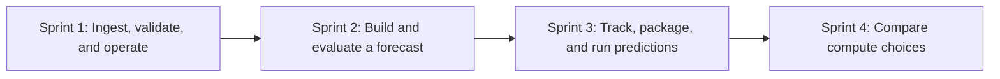

# Market Data ML Pipeline roadmap

By the end of the workshop, students should be able to trace a gold futures forecast from the source bars through training, evaluation, and a saved batch prediction. They should also be able to explain when this workload fits on one machine and when a distributed engine would help.

Checked items exist in the project. Unchecked items are class demos or planned work. Cloud release steps are called out separately from code that is ready on `dev`.

## Sprint 1 · Data engineering and DataOps

- [x] **Local daily lesson.** Run the [ingestion notebook](../notebooks/01_historical_ingestion.ipynb) or the CLI with synthetic `XAUUSD-DEMO` data. Inspect Bronze Parquet and its metadata, validate prices with Polars for Silver, and calculate trailing features for Gold. Query Silver and Gold in SQLite.
- [x] **Hourly cloud ingestion.** The released Prefect flow fetches completed Yahoo Finance `GC=F` bars and writes hourly Silver and Gold to Supabase. Silver is the first stored layer in this path. The local daily lesson remains available without cloud accounts.
- [x] **Operate and recover.** Read Prefect logs and task states, retry temporary fetch failures, and fail invalid batches before storage. Use the latest saved bar and a short overlap to catch up after a missed run. Replay an older range explicitly and rerun it without duplicating keys. Silver and Gold commit together.
- [x] **Handle changes at the source.** The [schema drift lesson](SCHEMA_DRIFT.md) shows Bronze metadata, a rescued field, and an invalid row set aside in an in-memory SQLite quarantine. Hourly Silver persistence for `_rescued_data` is implemented on `dev`; apply the [additive Supabase schema change](DEPLOYMENT.md#2-set-up-supabase) before releasing it. Quarantine is a notebook exercise.
- [x] **Verify, release, and protect credentials.** The locked `uv` environment and fixture tests support local rehearsals. Develop on `dev`, review a release PR into `main`, and use GitHub Actions to run checks and release to Prefect when enabled. Store the Supabase URI in a Prefect Secret block and the Prefect key in GitHub Actions secrets. See the [deployment guide](DEPLOYMENT.md) and [dependency audit walkthrough](SECURITY.md).
- [ ] **Class wrap-up.** Use the [schedule PR](https://github.com/soloshun/market-data-ml-pipeline/pull/2) to show the move from 06:00 and 12:00 daily to 00:00, 06:00, 12:00, and 18:00 on weekdays in Accra. After merging, compare the deployed commit and schedule, then show how to pause or resume and inspect a catch-up run. If time allows, demonstrate a scoped failure alert. Leave time for questions and [student projects](STUDENT_ASSIGNMENT.md).

**Show at the end:** Re-run an ingestion window, explain why the same keys remain unique, and trace one record from its source through Silver and Gold.

## Sprint 2 · Machine learning lifecycle (Lecture 9)

Begin with a short walkthrough and discussion. Trace acquisition and cleaning back to Sprint 1, then explain what changes when a dataset needs to answer a prediction question. Build the training notebook in the coding session.

- [ ] **Frame the problem.** Predict the six-hour percentage return of `GC=F` at a fixed Accra checkpoint. For a noon prediction, use only completed, available bars and aim at the close of the bar ending at 18:00. Skip historical examples when the exact target is missing; six observed rows can span more than six clock hours.
- [ ] **Assemble and explore the dataset.** Join hourly Silver and Gold as shown in the [MLOps handoff](MLOPS.md). Freeze the input snapshot and record its source, query, and date range. Plot closes and returns, inspect gaps and warm-up nulls, and count usable examples at each checkpoint. Stored bars can include provider revisions, so the snapshot alone does not prove what was available historically at every checkpoint. Prepare a longer synthetic hourly sample for anyone without Supabase access; the short ingestion fixture is only for smoke tests.
- [ ] **Choose a small feature set.** Start with trailing returns, moving averages, and volatility already in Gold. Add sine and cosine of the UTC checkpoint hour to show why midnight and late evening are close on a clock. Compare with and without the new features using the same validation data.
- [ ] **Train and evaluate.** Compare a zero-return baseline with one tree model, starting with XGBoost. Split by time; leave a six-hour gap at split boundaries so labels do not overlap the next split. Tune a few settings on the validation period and report mean absolute error in percentage points on an untouched test period. If the model does not beat the baseline, show both results and keep the baseline as the default for the demo.

**Show at the end:** One notebook that recreates the examples, explains one input-to-target row, and reports baseline and model scores on the same dates.

## Sprint 3 · From experiment to batch inference (MLOps lecture)

Use this session to answer three questions: What was trained? Which version should run? How will we know when it stops working?

- [ ] **Track runs.** Record the snapshot ID, split dates, features, hyperparameters, metrics, and code revision for each trial. Demonstrate [MLflow Tracking on local SQLite](https://mlflow.org/docs/latest/ml/tracking/tutorials/local-database/) if time and setup allow. A small run table is the fallback and keeps the lesson runnable without a tracking service.
- [ ] **Package and select a version.** Save the chosen model artifact with the expected feature columns and its run ID. Reload that exact version for inference. Show what a model registry adds, and keep a selected version in a small manifest if no registry is set up. For the Prefect exercise, pass the chosen hyperparameters through a configuration block. Keep the model artifact and its version separate from those settings.
- [ ] **Train and predict separately.** Train on demand. Run one local batch prediction from a saved model at a named checkpoint and store its model version, forecast timestamp, target timestamp, and predicted return. Rerunning the same model version and checkpoint should update the same record. If the local demo is stable and the workspace has room, optionally schedule inference after ingestion succeeds. Leave training off the ingestion schedule.
- [ ] **Monitor and maintain.** Start with data freshness, missing inputs, and failed runs. Once the target arrives, join it to the saved forecast and compare recent error with the baseline. Explain the difference between schema drift (fields changed), data drift (input values shifted), and performance drift (errors worsened). Use those checks to decide when to investigate or retrain.

**Show at the end:** Take one saved prediction and trace it back to the exact model, training run, and input snapshot. AWS hosting, a permanent MLflow server, and a public inference API are discussion topics or extensions.

## Sprint 4 · Single machine and distributed compute

- [ ] **Teach the execution model.** Explain why Spark exists and what its driver, executors, partitions, and shuffle do. Show how work can use several cores on one machine before showing what changes across machines. [Spark cluster overview](https://spark.apache.org/docs/latest/cluster-overview.html)
- [ ] **Benchmark a real operation.** Use seeded synthetic market data at several sizes. Give pandas and Polars the same columns, dtypes, filter, and grouped aggregation. Check equal results, warm up, repeat the timed runs, and report median time. Keep file reads separate from computation. Report data size and Polars' [thread pool size](https://docs.pola.rs/api/python/stable/reference/api/polars.thread_pool_size.html); a separate one-thread Polars run can help explain where parallelism helps. Let the results determine which tool wins each case.
- [ ] **Try the same operation in local PySpark.** Explain why startup and shuffle can cost more than the work itself on small inputs. Local Spark is still one machine. Use a synthetic table-size inventory for the Databricks case study; discuss memory, growth, and workload when deciding what to distribute. A real cluster or distributed model training is optional.

**Show at the end:** One timing table and a short recommendation for this project, supported by the measurements. Keep the ingestion and forecasting demos runnable on a laptop.
