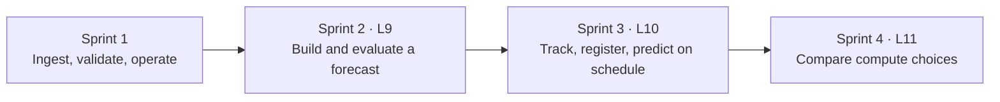
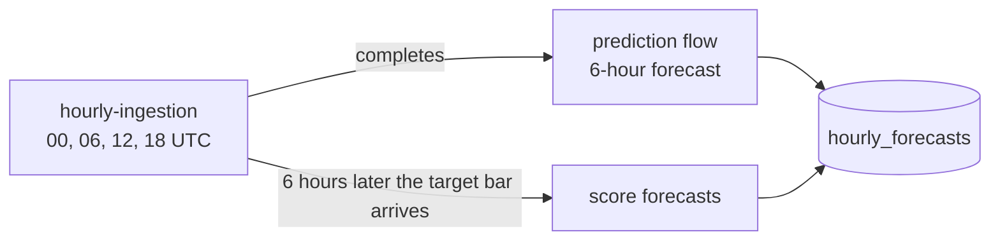

# Market Data ML Pipeline roadmap

By the end of the workshop, students should be able to trace a gold futures forecast from the source bars through training, evaluation, and a saved batch prediction. They should also be able to explain when this workload fits on one machine and when a distributed engine would help.

Checked items exist in the project. Unchecked items are class demos or planned work. Cloud release steps are called out separately from code that is ready on `dev`.

**Guiding rule:** keep every step runnable on a laptop with free tiers. Add one new idea at a time and reuse what already exists. For example, new features go into the existing Gold table, and the prediction flow copies the ingestion flow's structure.

| Sprint | Lecture | Topic | Main guide | Status |
| --- | --- | --- | --- | --- |
| 1 | Data engineering sessions | Ingest, validate, store, orchestrate, release | [Theory slides](https://gamma.app/docs/Theory-Working-Pipeline-s6v9hogx9py3t3s), [notebook](../notebooks/01_historical_ingestion.ipynb) | Wrapping up |
| 2 | Lecture 9 | Machine learning lifecycle: dataset, features, models, tuning | [MLOPS.md](MLOPS.md) | Planned |
| 3 | Lecture 10 | MLflow: tracking, packaging, registry, serving and batch inference | [MLOPS.md](MLOPS.md) | Planned |
| 4 | Lecture 11 | Spark, single machine vs distributed, pandas vs Polars | Notebook Section 7 | Partly built |

**Where it ends up:** every weekday at 00:00, 06:00, 12:00 and 18:00 (Accra = UTC), ingestion loads the latest completed hourly bars. A few minutes after it finishes, a prediction flow forecasts the next six hours and stores the forecast. When the six hours have passed, the forecast is scored against what actually happened.

## Sprint 1 · Data engineering and DataOps

- [x] **Foundations.** The [Theory → Working Pipeline slides](https://gamma.app/docs/Theory-Working-Pipeline-s6v9hogx9py3t3s) cover pipeline anatomy, batch vs streaming vs incremental, medallion storage, data quality, history tracking, ETL vs ELT and the dev-to-prod workflow. The [concepts map](CONCEPTS.md) links each idea to the code.
- [x] **Local daily lesson.** Run the [ingestion notebook](../notebooks/01_historical_ingestion.ipynb) or the CLI with synthetic `XAUUSD-DEMO` data. Inspect Bronze Parquet and its metadata, validate prices with Polars for Silver, and calculate trailing features for Gold. Query Silver and Gold in SQLite.
- [x] **Hourly cloud ingestion.** The released Prefect flow fetches completed Yahoo Finance `GC=F` bars and writes hourly Silver and Gold to Supabase. Silver is the first stored layer in this path. The local daily lesson remains available without cloud accounts.
- [x] **Operate and recover.** Read Prefect logs and task states, retry temporary fetch failures, and fail invalid batches before storage. Use the latest saved bar and a short overlap to catch up after a missed run. Replay an older range explicitly and rerun it without duplicating keys. Silver and Gold commit together.
- [x] **Handle changes at the source.** The [schema drift lesson](SCHEMA_DRIFT.md) covers the kinds of drift and four responses: rescue, fail fast, quarantine and evolve. Hourly Silver persists `_rescued_data` on `dev`. Apply the [additive Supabase schema change](DEPLOYMENT.md#2-set-up-supabase) before releasing it. Quarantine is a notebook exercise.
- [x] **Verify, release, and protect credentials.** The locked `uv` environment and fixture tests support local rehearsals. Develop on `dev`, review a release PR into `main`, and use GitHub Actions to run checks and release to Prefect when enabled. Store the Supabase URI in a Prefect Secret block and the Prefect key in GitHub Actions secrets. See the [deployment guide](DEPLOYMENT.md), which shows both terminal and UI routes.
- [x] **Security gate.** On every PR into `main`, the dependency audit fails the checks when a locked package has a known vulnerability. See the [security walkthrough](SECURITY.md).
  - [ ] Turn on the `protect-main` ruleset ([SECURITY.md §4](SECURITY.md#4-make-the-security-check-block-the-merge)). Without it, a failing check doesn't stop the Merge button.
- [ ] **Finish the code walkthrough.** Cover the remaining modules with the [reading order](ARCHITECTURE.md#read-the-code-in-this-order). Leave some parts for students to discover through the [warm-up exercises](STUDENT_ASSIGNMENT.md#part-1--warm-up-exercises).
- [ ] **Class wrap-up: push to production.** Use the [schedule PR](https://github.com/soloshun/market-data-ml-pipeline/pull/2) to move from 06:00 and 12:00 daily to 00:00, 06:00, 12:00 and 18:00 on weekdays in Accra. Review the diff, watch **checks**, merge, watch **deploy**, then compare the deployed commit and schedule in Prefect. Show how to pause or resume and inspect a catch-up run. If time allows, demonstrate a scoped failure alert. Leave time for questions and [student projects](STUDENT_ASSIGNMENT.md).

**Show at the end:** Re-run an ingestion window, explain why the same keys remain unique, and trace one record from its source through Silver and Gold.

## Sprint 2 · Machine learning lifecycle (Lecture 9)

Begin with a short walkthrough and discussion. Trace acquisition and cleaning back to Sprint 1, then explain what changes when a dataset needs to answer a prediction question. Build the training notebook in the coding session.

- [ ] **Frame the problem.** Predict the six-hour percentage return of `GC=F` at each weekday checkpoint (00:00, 06:00, 12:00, 18:00 UTC). For a noon prediction, use only completed bars, the last one starting at 11:00, and aim at the close of the bar ending at 18:00. To show a price, multiply the latest close by one plus the predicted return. Returns are easier to model than raw prices because their scale doesn't drift with the gold price. Skip historical examples when the exact target is missing. Six observed rows can span more than six clock hours.
- [ ] **Assemble and explore the dataset.** Join hourly Silver and Gold as shown in the [MLOps handoff](MLOPS.md). Freeze the input snapshot and record its source, query, and date range. Plot closes and returns, inspect gaps and warm-up nulls, and count usable examples at each checkpoint. Stored bars can include provider revisions, so the snapshot alone does not prove what was available historically at every checkpoint. Prepare a longer synthetic hourly sample for anyone without Supabase access. The short ingestion fixture is only for smoke tests.
- [ ] **Add features in Gold, not in the notebook.** Extend `build_hourly_features` so training and prediction use the same code. This avoids training/serving skew, where the model sees features computed one way in training and another way in production. Every feature must be trailing, using only the current and earlier bars. Candidates, roughly from simplest:
  - lagged returns over 1, 2, 3 and 6 bars, and the 6- and 24-bar momentum
  - distance from trend: `close / sma_20 − 1`
  - 20-bar volatility and the bar range `(high − low) / close`
  - volume relative to its 20-bar mean
  - sine and cosine of the UTC hour, and the day of week, to show why 23:00 and 00:00 are close on a clock

  Adding columns to `hourly_features` is a deliberate **schema evolution**. Update both SQL schemas, the upsert and the tests together, as described in [SCHEMA_DRIFT.md](SCHEMA_DRIFT.md#step-5--evolve-the-schema-on-purpose). Compare the model with and without the new features on the same validation dates.
- [ ] **Train and compare models.** Start with a zero-return baseline, then train **XGBoost** and **LightGBM** on the same features and splits. Split by time, never randomly, and leave a six-hour gap at split boundaries so labels don't overlap the next split. Report mean absolute error in percentage points on an untouched test period. If no model beats the baseline, show the results anyway and keep the baseline as the default for the demo. That outcome is a useful lesson too.
- [ ] **Tune hyperparameters.** First, run an exhaustive grid search over a small grid, for example tree depth × learning rate × number of trees, using expanding-window time-series cross-validation. It is easy to explain and to check. Then run [Optuna](https://optuna.org/) with the same number of trials to show how a smarter search finds good settings faster. Tune on the validation folds only, and touch the test period once at the end.

**Show at the end:** One notebook that recreates the examples, explains one input-to-target row, and reports baseline, XGBoost and LightGBM scores on the same dates.

## Sprint 3 · From experiment to batch inference (Lecture 10 · MLflow)

Use this session to answer three questions: What was trained? Which version should run? How will we know when it stops working? The lecture order: challenges in traditional ML → from experimentation to deployment → MLflow → tracking, packaging, registration, serving and inference → putting it all together.

- [ ] **Show the problem first.** Open the Sprint 2 notebook and ask: which settings produced the best score last week? Which data was it trained on? Without tracking, nobody knows. This is the "challenges in traditional ML" slide, made concrete.
- [ ] **Track runs with MLflow.** Run [MLflow Tracking on local SQLite](https://mlflow.org/docs/latest/ml/tracking/tutorials/local-database/), so no server is needed. Log each tuning trial from Sprint 2 as a run with the snapshot ID, split dates, feature list, hyperparameters, metrics and git commit. Compare runs in the MLflow UI. If MLflow setup fails in class, a small CSV run table keeps the lesson moving.
- [ ] **Package and register.** Log the chosen model with its MLflow flavor (`mlflow.xgboost` or `mlflow.lightgbm`), together with an input signature listing the expected feature columns. Register it in the **Model Registry** and give the chosen version the alias `champion`. Prediction code loads `models:/<name>@champion`, so promoting a new version only means moving the alias. For the Prefect exercise, pass hyperparameters through a configuration block, kept separate from the model artifact and its version.
- [ ] **Serve: batch first, real-time as a demo.** The main path is **batch inference**: a Prefect prediction flow that loads the `champion` model, reads the latest Gold row at a checkpoint, and upserts a forecast. The forecast records the symbol, checkpoint time, target time, model version, predicted return and the time it was predicted. Key it by `(symbol, checkpoint_utc, model_version)` so reruns update the same row. Optionally show `mlflow models serve` locally to contrast real-time REST serving with batch.
- [ ] **Run it after ingestion.** The simple option is a cron about 10 minutes after each ingestion run (`10 */6 * * 1-5`). The sturdier option is a Prefect **deployment trigger** that starts prediction when `hourly-ingestion` completes. Comparing the two makes a good discussion: what happens to each when ingestion runs late? Keep training on demand, off the ingestion schedule.
- [ ] **Automatic backfill for a near-real-time pipeline.** If the prediction flow misses checkpoints, for example after an outage, the next run should find checkpoints that have bars but no forecast and fill them in. It uses only the features available at each checkpoint (point-in-time), just as ingestion catch-up uses a watermark. Mark these forecasts as backfilled (`predicted_at` later than the checkpoint) so they are evaluated separately. A backfilled forecast never *could* have been used live. Forecasts are append-only: when a bar is revised later, keep the original forecast as it was made.
- [ ] **Monitor and maintain.** A scoring step fills in the actual return once the target bar arrives. These are late-arriving labels. Start with data freshness, missing inputs and failed runs. Then compare recent error with the baseline. Explain the difference between schema drift (fields changed), data drift (input values shifted), concept drift (the input-to-target relationship changed) and performance drift (errors worsened). Use those checks to decide when to investigate or retrain.

**Show at the end:** Take one saved prediction and trace it back to the exact model version, MLflow run, and input snapshot. AWS hosting, a permanent MLflow server, and a public inference API are discussion topics or extensions.

## Sprint 4 · Single machine and distributed compute (Lecture 11)

Lecture order: what Spark is and how it works → why it was created → when and when not to use it → case study: scanning table sizes across Databricks workspaces → solutions and a performance comparison → conclusions → classroom benchmark.

- [ ] **Teach the execution model.** Explain what the driver, executors, partitions and shuffle do, and how Spark builds a lazy plan, much like Polars' `scan_parquet` in notebook Section 7. Show how work can use several cores on one machine before showing what changes across machines. [Spark cluster overview](https://spark.apache.org/docs/latest/cluster-overview.html)
- [ ] **Explain why Spark exists.** Hadoop MapReduce wrote intermediate results to disk between every step. Spark keeps them in memory, which made iterative ML and interactive queries practical on clusters. Then ask what has changed since: a single laptop now has many cores and plenty of RAM, and engines such as Polars and DuckDB use them well.
- [ ] **Case study.** Use a synthetic table-size inventory for the Databricks workspace scan. Discuss memory, data growth and workload shape when deciding what to distribute. Compare the candidate solutions on the same input.
- [ ] **Benchmark a real operation.** [Notebook Section 7](../notebooks/01_historical_ingestion.ipynb) already compares pandas with PyArrow against lazy Polars on one size, about 2 million rows, and checks that the results match. Extend it to several sizes, and add a `POLARS_MAX_THREADS=1` run in a separate process to separate the effect of threads from the effect of the query plan. Note that pandas computes mostly on one thread, but its PyArrow Parquet reader can use several. Keep file reads separate from computation, warm up, repeat, and report median time and Polars' [thread pool size](https://docs.pola.rs/api/python/stable/reference/api/polars.thread_pool_size.html). Let the results decide which tool wins each case.
- [ ] **Try the same operation in local PySpark.** Explain why startup and shuffle can cost more than the work itself on small inputs. Local Spark is still one machine. A real cluster or distributed model training is optional.

**Show at the end:** One timing table and a short recommendation for this project, supported by the measurements. Keep the ingestion and forecasting demos runnable on a laptop.
