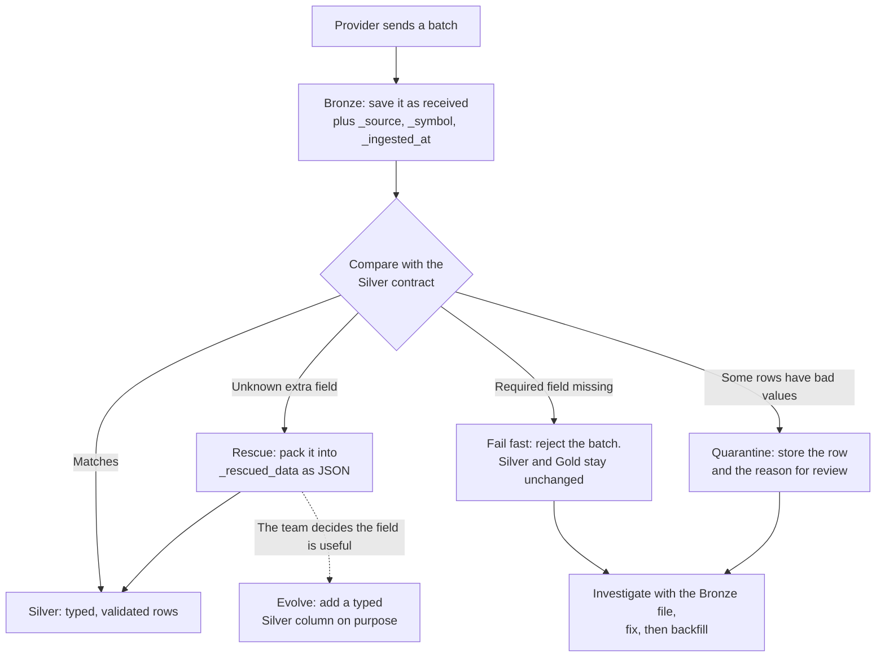

# Schema drift: rescue, reject, quarantine, evolve

A pipeline makes a promise to the people downstream: *"Silver always has these columns, with these types, and these rules hold."* The provider upstream made no such promise. When the shape of what arrives changes, you have **schema drift**. This guide explains the kinds of drift you will meet, the four standard responses, and where each one lives in this repository.

> **In one sentence:** keep what arrived (Bronze), check it against a contract (validation), set aside what you don't recognise (rescue) or can't use (quarantine), stop when a required field is missing (fail fast), and change the contract only on purpose (evolution).

**Run it:** notebook Section 3a in [the daily notebook](../notebooks/01_historical_ingestion.ipynb) (about five minutes). The code is in [`validation.py`](../src/market_data/ingestion/validation.py).

## 1. What can drift?

"Schema" means more than column names. Each row below is a different kind of drift, using examples from this project.

| Kind of drift | Example in this project | What goes wrong if you ignore it | Usual response |
| --- | --- | --- | --- |
| **Added field** | The provider starts sending `VendorNote` | Nothing breaks, but you silently lose information | **Rescue** it |
| **Removed or renamed field** | `High` disappears, or arrives as `high_price` | Features and checks cannot be calculated | **Fail fast** |
| **Type or value change** | `High` arrives as the text `"unknown"` | A lenient cast quietly turns it into a null | **Validate**, then **quarantine** or fail |
| **Layout change** | yfinance switched single-ticker downloads to two-level column headers | The adapter can't find the columns | Fix the **adapter** and add a test |
| **Meaning change** | yfinance now defaults to `auto_adjust=True`, so `Close` becomes a dividend- and split-adjusted price | **No error at all.** The numbers are just different | **Pin parameters** explicitly and reconcile |

The last row is the most dangerous because nothing fails. This repository protects against it by passing `auto_adjust=False` and `multi_level_index=False` explicitly in [`_download_yahoo`](../src/market_data/ingestion/sources.py), and [`test_download_options`](../tests/test_ingest.py) asserts those options. If we relied on the library's defaults, a routine dependency upgrade could change what `Close` means.

> **Schema drift is not data drift.** Schema drift is about the *shape and meaning* of fields. **Data drift** is when the shape stays the same but the *distribution* of values changes, for example when gold becomes twice as volatile. Data drift matters most for models, so the MLOps sessions cover it.

## 2. How a batch is handled



Bronze sits *before* the contract check on purpose. Whatever happens next, you still have the input that caused it.

### What this repository actually does

| Response | Daily flow (local lesson) | Hourly flow (Prefect Cloud) | Where to read it |
| --- | --- | --- | --- |
| Keep the raw input | Bronze Parquet with metadata | No Bronze (fresh Yahoo fetch each run) | [`save_snapshot`](../src/market_data/ingestion/sources.py) |
| Validate against a contract | ✅ every run | ✅ every run | [`validate_prices`, `validate_hourly_prices`](../src/market_data/ingestion/validation.py) |
| Fail fast on missing fields or bad rows | ✅ the whole batch is rejected | ✅ the whole batch is rejected | `_check_source`, `_check_rows` |
| Rescue unknown fields | Notebook preview only | ✅ stored in `hourly_prices._rescued_data` | [`rescue_extra_columns`](../src/market_data/ingestion/validation.py) |
| Quarantine bad rows | Notebook demo only, in-memory | — | Notebook Section 3a |
| Evolve the schema | Exercise for you | Exercise for you | [Section 6](#6-practice) |

Databricks calls named quality rules like these **expectations**. Each has an action: *warn* and keep the row, *drop* the row, or *fail* the batch. The `checks` dictionaries in `validation.py` are expectations whose action is always *fail*. The flows deliberately **reject the whole batch** instead of quarantining. For a 30-row teaching dataset, a loud failure is easier to reason about than a partial load. Section 5 discusses when you would choose differently.

## 3. Walk through it with three fixture rows

All of this uses the first three synthetic `XAUUSD-DEMO` rows from the [fixture](../src/market_data/data/market_sample.csv).

### Step 1 · Bronze remembers where each row came from

Bronze adds three metadata columns to whatever the source sent. The snapshot time below is illustrative. Every row in one Parquet file shares the same `_ingested_at`.

| `Date` | `_ingested_at` | `_source` | `_symbol` |
| --- | --- | --- | --- |
| 2025-01-06 | 2026-11-12 15:00 UTC | fixture | XAUUSD-DEMO |
| 2025-01-07 | 2026-11-12 15:00 UTC | fixture | XAUUSD-DEMO |
| 2025-01-08 | 2026-11-12 15:00 UTC | fixture | XAUUSD-DEMO |

- `Date` is **event time**, the market session the price belongs to.
- `_ingested_at` is **processing time**, when the pipeline saved this copy. If you replay the same rows tomorrow, `Date` stays the same and `_ingested_at` moves forward.
- `_source` and `_symbol`, together with the file path, let you trace any Silver row back to the exact input. This is called **lineage**.

### Step 2 · Rescue a field you didn't expect

The notebook adds a fictional `VendorNote` column in memory:

| `Date` | `High` | `Close` | `VendorNote` |
| --- | ---: | ---: | --- |
| 2025-01-06 | 2606 | 2598 | demo feed |
| 2025-01-07 | 2605 | 2598 | demo feed |
| 2025-01-08 | 2604 | 2598 | demo feed |

`rescue_extra_columns` keeps every known field and packs anything else into one JSON column:

| `Date` | `High` | `_rescued_data` |
| --- | ---: | --- |
| 2025-01-06 | 2606 | `{"VendorNote":"demo feed"}` |
| 2025-01-07 | 2605 | `{"VendorNote":"demo feed"}` |
| 2025-01-08 | 2604 | `{"VendorNote":"demo feed"}` |

The notebook then asserts that Silver is **identical** to the original three rows. The new field did not break anything, and it was not thrown away.

In the hourly flow this column is stored: as `jsonb` in [PostgreSQL](../sql/schema.sql) and as JSON text in SQLite. Normal bars have `NULL`. If a later rerun receives the same bar *without* extra fields, the upsert keeps the earlier payload (`COALESCE`). Gold features are calculated only from the validated price columns. The idea comes from Databricks Auto Loader's [rescued data column](https://docs.databricks.com/aws/en/ingestion/cloud-object-storage/auto-loader/schema).

### Step 3 · Fail fast when a required field disappears

If `High` is missing, no rescue can help. You can't compute OHLC checks without it. The validator raises an error that names the problem:

```text
XAUUSD-DEMO: missing required columns: High.
```

In the real flow, `validate_and_transform` fails, `store_market_data` never starts, and the database is untouched. Try it with `uv run market-data run --source fixture --skip-db --demo-failure invalid`.

### Step 4 · Quarantine a row you can't use

Now `High` exists but one row says `"unknown"`. The notebook catches the validation error and stores the raw row with the reason in a temporary SQLite table:

| `trade_date` | `symbol` | Raw `High` | Reason (excerpt) |
| --- | --- | --- | --- |
| 2025-01-07 | XAUUSD-DEMO | unknown | price must be finite and positive |

A real quarantine table would be permanent. It would also record the batch ID and Bronze file path so someone can fix the row and replay it. The good rows would carry on to Silver. The notebook's table disappears when the cell closes its connection. [Databricks quarantine pattern](https://docs.databricks.com/aws/en/ldp/expectation-patterns)

### Step 5 · Evolve the schema on purpose

Suppose analysts decide `VendorNote` is useful. Agree what it means, then add a **nullable** `vendor_note` column to Silver in the SQL schema, the validator, the storage code and the tests together. Existing rows get `NULL` until you backfill them:

| `trade_date` | `high` | `vendor_note` |
| --- | ---: | --- |
| 2025-01-06 | 2606 | `NULL` |
| 2025-01-08 | 2604 | demo feed |

That deliberate, reviewed change is **schema evolution**. Drift happens to you. Evolution is a decision you make. [Delta Lake schema evolution](https://docs.databricks.com/aws/en/data-engineering/schema-evolution)

## 4. Why Bronze matters here

Every response above depends on having the original input:

- After a **failed** batch, open the Bronze file to see exactly what arrived.
- After you **evolve** a schema, re-read old Bronze files to backfill the new column.
- When someone asks *"why is this number wrong?"*, `_source`, `_symbol` and `_ingested_at` tell you which input produced it.

The hourly Cloud flow has no Bronze layer because a Prefect Managed worker's disk disappears after each run. To add one, write snapshots to durable object storage such as S3 or Supabase Storage.

## 5. Choosing a strategy

| Strategy | Best when | Cost |
| --- | --- | --- |
| **Fail the whole batch** (this repo) | Batches are small, correctness matters more than freshness, and someone watches failures | One bad row blocks all good rows |
| **Quarantine bad rows** | Large batches where a few bad rows are normal and fresh data matters | Someone must own the quarantine table and replay fixed rows |
| **Rescue unknown fields** | Providers add fields often and you don't want to lose them | Rescued JSON is untyped. Don't build features on it |
| **Evolve automatically** | Exploratory data, internal sources you trust | Downstream code can break without anyone deciding to change it |

Most production pipelines combine them: rescue additions, quarantine row-level problems, fail on missing required fields, and review every schema change in a pull request.

## 6. Practice

Try one of these on a branch, with a test for each:

1. **Store daily rescued data.** Call `rescue_extra_columns` in `validate_prices`. Add `_rescued_data` to `market_prices` in both SQL schemas, then follow the hourly flow as a model.
2. **Build a real quarantine.** Change validation to *return* bad rows instead of raising. Write them to a `quarantine_prices` table with the reason and Bronze path, and let good rows continue. Decide what should happen if *every* row is bad.
3. **Catch a meaning change at run time.** `test_download_options` already fails if someone removes `auto_adjust=False`. Add a second guard: log a warning when a Yahoo batch arrives without `Adj Close`, a hint that `Close` may already be adjusted. Explain to a classmate why this kind of drift never raises an error by itself.
4. **Detect a rename.** Make validation suggest a likely match when a required field is missing, for example `high_price` instead of `High`.

## Further reading

- [Databricks Auto Loader: schema inference, evolution and rescued data](https://docs.databricks.com/aws/en/ingestion/cloud-object-storage/auto-loader/schema)
- [Databricks: quarantine with expectations](https://docs.databricks.com/aws/en/ldp/expectation-patterns)
- [Apache Iceberg schema evolution](https://iceberg.apache.org/docs/latest/evolution/) and [Athena's Iceberg guide](https://docs.aws.amazon.com/athena/latest/ug/querying-iceberg-evolving-table-schema.html)
- [Pandera](https://pandera.readthedocs.io/) and [Great Expectations](https://docs.greatexpectations.io/) are Python libraries for declaring and enforcing data contracts
- [dbt model contracts](https://docs.getdbt.com/docs/mesh/govern/model-contracts) enforce the same idea for SQL models
