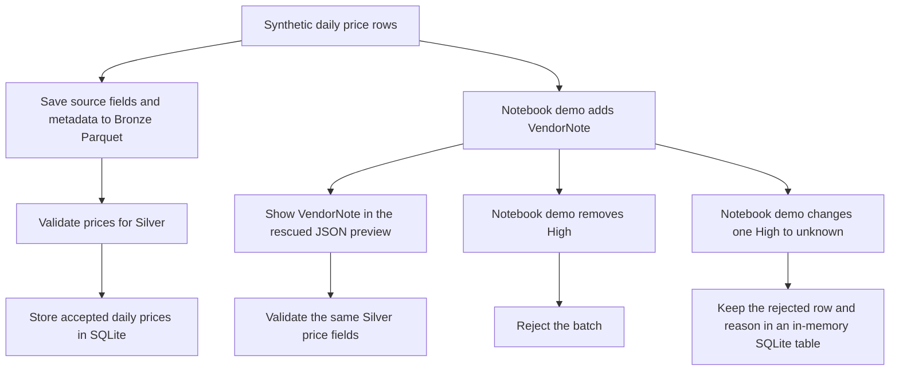

# Schema drift and ingestion metadata

Follow the first three synthetic `XAUUSD-DEMO` rows from the [market data fixture](../src/market_data/data/market_sample.csv). Section 2 of the [daily notebook](../notebooks/01_historical_ingestion.ipynb) saves the fixture to Bronze. Section 3a reuses those rows to show what happens when a provider changes the fields it sends.

## Read a Bronze row

This is the metadata view from the notebook, with an illustrative snapshot time. Every row in the same Parquet snapshot receives the same `_ingested_at`.

| `Date` | `_ingested_at` | `_source` | `_symbol` |
| --- | --- | --- | --- |
| 2025-01-06 | 2026-11-12 15:00 UTC | fixture | XAUUSD-DEMO |
| 2025-01-07 | 2026-11-12 15:00 UTC | fixture | XAUUSD-DEMO |
| 2025-01-08 | 2026-11-12 15:00 UTC | fixture | XAUUSD-DEMO |

`Date` identifies the market session. `_ingested_at` records when the pipeline saved this copy. If you replay the same observations tomorrow, their market dates stay the same and the snapshot time advances. `_source` identifies the fixture or provider. `_symbol` identifies the instrument. Together with the printed Parquet path, these fields help you find the input that produced a result.

## Rescue a new field

Suppose the provider adds `VendorNote` to the batch. This is **schema drift**. The notebook simulates it in memory. The table shows selected input columns.

| `Date` | `High` | `Close` | `VendorNote` |
| --- | ---: | ---: | --- |
| 2025-01-06 | 2606 | 2598 | demo feed |
| 2025-01-07 | 2605 | 2598 | demo feed |
| 2025-01-08 | 2604 | 2598 | demo feed |

The rescue helper gathers unfamiliar fields into JSON. The notebook displays this preview and checks that Silver validates to the same prices as the original fixture.

| `Date` | `High` | `_rescued_data` |
| --- | ---: | --- |
| 2025-01-06 | 2606 | `{"VendorNote":"demo feed"}` |
| 2025-01-07 | 2605 | `{"VendorNote":"demo feed"}` |
| 2025-01-08 | 2604 | `{"VendorNote":"demo feed"}` |

The workshop helper handles added fields. Databricks Auto Loader can also rescue certain type and case mismatches. [Databricks rescued data](https://docs.databricks.com/gcp/en/ingestion/cloud-object-storage/auto-loader/schema)

The [hourly flow](../src/market_data/flows/hourly_ingestion.py) calls the same helper during Silver validation and saves `_rescued_data` in `hourly_prices`. SQLite stores it as JSON text; [PostgreSQL](../sql/schema.sql) stores it as `jsonb`. Normal bars have `NULL`. If a rerun receives the same bar without unfamiliar fields, it keeps the previous payload. A newer non-null payload replaces the earlier one. Gold still uses the validated prices to calculate features.

## Decide whether to evolve or quarantine

If analysts decide to use `VendorNote`, agree on its meaning and add a nullable `vendor_note` text field to Silver. That deliberate change is **schema evolution**. For example, before backfilling older rows, an evolved table could look like this.

| `trade_date` | `high` | `vendor_note` |
| --- | ---: | --- |
| 2025-01-06 | 2606 | `NULL` |
| 2025-01-08 | 2604 | demo feed |

If the provider sends `High="unknown"`, the price row needs repair. A **quarantine** keeps the invalid input and the reason so the team can investigate and replay it. The notebook puts the full synthetic row in a temporary SQLite table and shows these fields.

| `trade_date` | `symbol` | Raw `High` | Reason (excerpt) |
| --- | --- | --- | --- |
| 2025-01-07 | XAUUSD-DEMO | unknown | price must be finite and positive |

The table disappears when the demo cell closes the connection. The actual flows fail the batch if a required field is missing or invalid. For a rejected daily batch, open its Bronze file to see what arrived. [Schema evolution](https://docs.databricks.com/gcp/en/data-engineering/schema-evolution) · [Quarantine example](https://docs.databricks.com/aws/en/ldp/expectation-patterns)

## If the workshop moves to S3 later

The exercise above uses local Parquet and SQLite. In a future S3 version, Bronze objects could keep the original payload, a staging table could hold `_rescued_data`, and quarantine rows could reference the source object key and batch ID. A curated Iceberg table can add an approved field through explicit schema evolution. [Athena Iceberg schema evolution](https://docs.aws.amazon.com/athena/latest/ug/querying-iceberg-evolving-table-schema.html)
